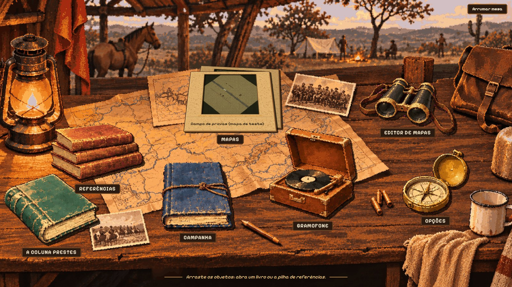
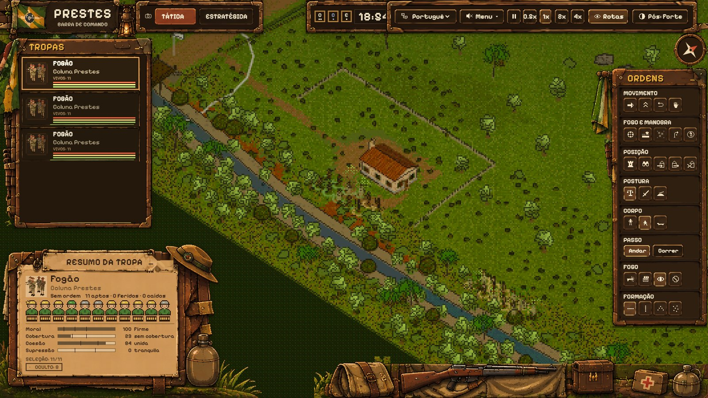
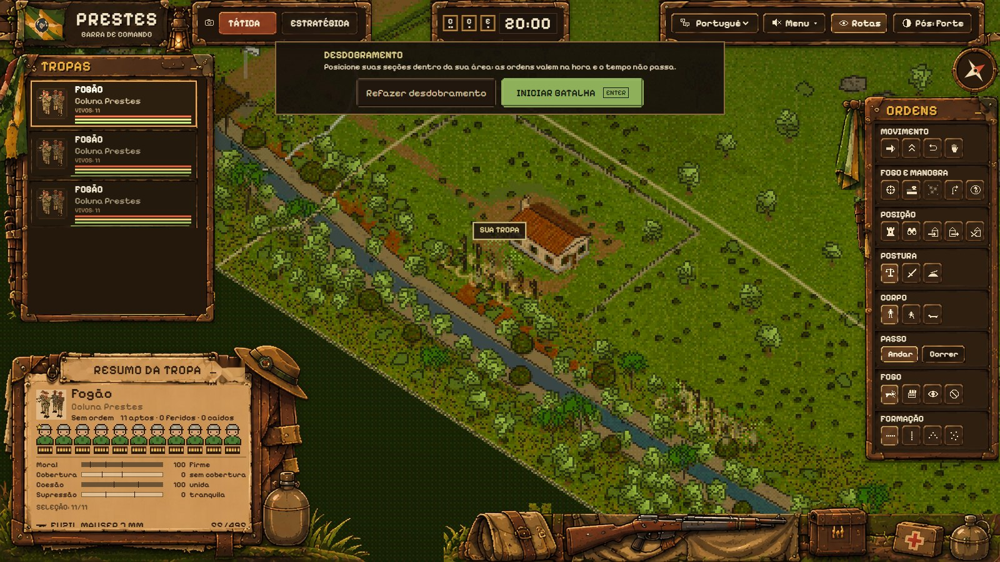
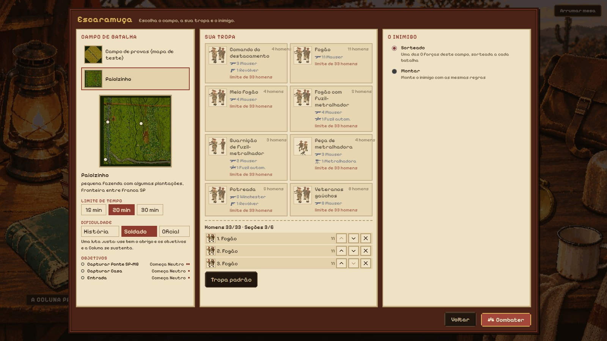
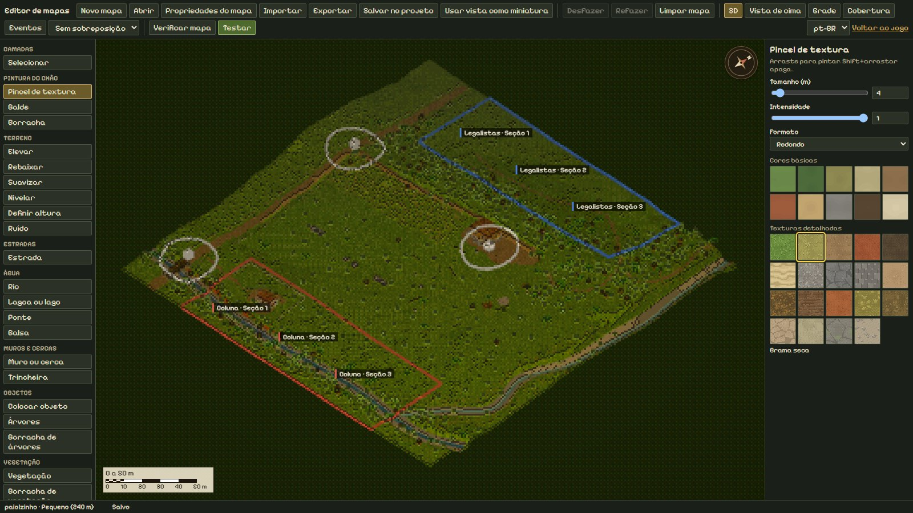
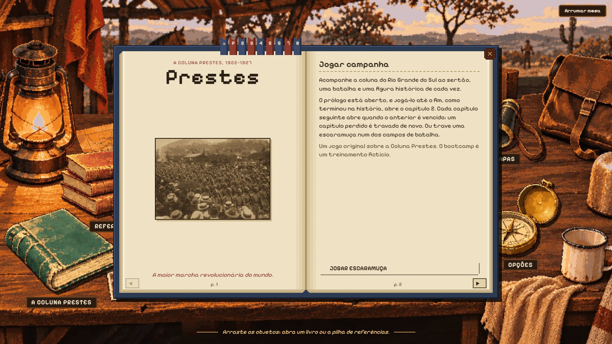
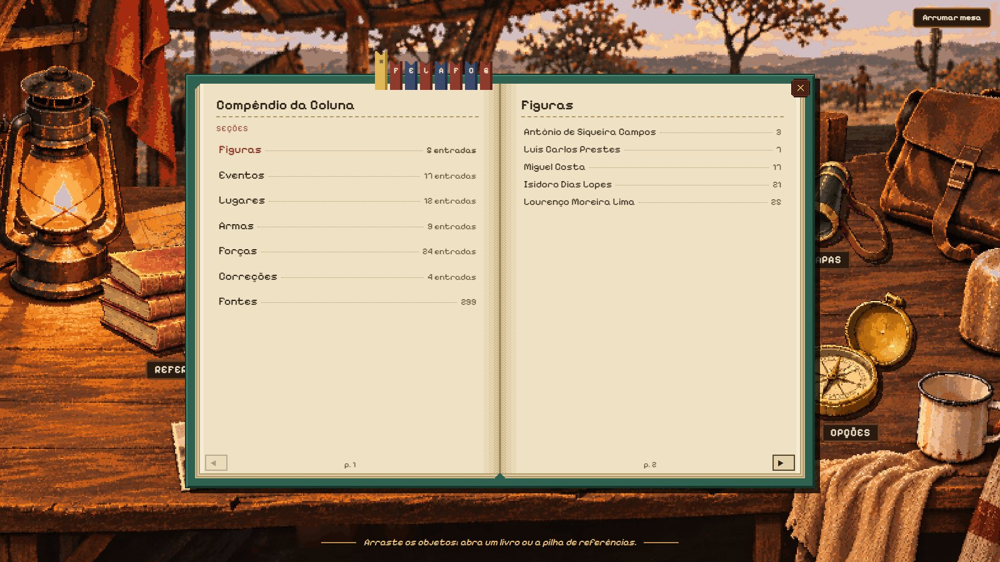

<h1 align="center">Prestes</h1>

<p align="center"><strong>One column against a whole country. Every order costs a march.</strong></p>

<p align="center">
  <a href="https://gamestudio42.github.io/prestes/"></a>
  <a href="https://github.com/gamestudio42/prestes/actions/workflows/pages.yml"></a>
  <a href="https://github.com/gamestudio42/prestes/stargazers"></a>
  <a href="https://github.com/gamestudio42/prestes/fork"></a>
  <a href="https://github.com/gamestudio42"></a>
  <a href="LICENSE"></a>
</p>

<p align="center">
  A historical real-time tactics game about Luís Carlos Prestes and the Coluna Prestes
  (1922–1927), running in the browser. Build your sections from period rosters, deploy
  them on hand-drawn battlefields and fight for the objectives under fog of war.
  No install. Interface in Portuguese and English.
</p>

<p align="center">
  <a href="https://gamestudio42.github.io/prestes/">
    
  </a>
</p>

<p align="center">
  <a href="https://gamestudio42.github.io/prestes/">
    
  </a>
</p>

## Map editor

Every battlefield is drawn by hand in the in-game map editor, and you can draw
your own. The guides walk through it:

- **[Map editor reference](docs/map-editor.md)** (English): maps, sizes,
  painting, terrain, roads, water, walls, objects, deployment areas,
  objectives, checks and testing a map in battle.
- **[Guia para desenhar os mapas da campanha](docs/maps/GUIA_MAPAS_CAMPANHA.md)**
  (português): a step-by-step tutorial for drawing each campaign battlefield
  from its historical sources.
- **[Eventos de batalha no editor](docs/maps/EVENTOS_DE_BATALHA.md)**
  (português): reinforcements, offensives, retreats, artillery and story cards
  scripted inside a map.

Open it from the theodolite on the menu desk (**Map editor**), or at
`/editor.html` on the dev server.

## See the battle

<table>
<tr>
<td align="center" width="50%" valign="top">
<br>
The battle HUD: sections on the left, orders on the right, the map in between.
</td>
<td align="center" width="50%" valign="top">
<br>
Every battle opens in a deployment phase; time does not run until you start it.
</td>
</tr>
<tr>
<td align="center" width="50%" valign="top">
<br>
Pick the field, the time limit and the difficulty, then build your sections.
</td>
<td align="center" width="50%" valign="top">
<br>
The map editor, with deployment areas and objectives on Paiolzinho.
</td>
</tr>
<tr>
<td align="center" width="50%" valign="top">
<br>
The campaign book follows the column chapter by chapter.
</td>
<td align="center" width="50%" valign="top">
<br>
The compendium: figures, events, places, weapons and forces, with sources.
</td>
</tr>
</table>

## Why Prestes

- **Play in the browser.** Open the link and fight. Nothing to download.
- **A real war, told from the record.** The campaign follows the column from
  1922 to 1927; each chapter is commanded by the figure who was actually there.
  Macaulay's chronology, Amado's tone and Blanc's social history are the base,
  with page citations in [`docs/history/`](docs/history/SOURCES.md).
- **Sections, not blobs.** Fogões, half-fogões, light machine-gun teams,
  machine-gun pieces, potreadas and gaúcho veterans, each with its period
  weapons: Mauser, Winchester, revolvers, automatic rifles and machine guns.
- **Cover, morale and suppression.** Soldiers take cover by slot, enter and
  assault houses and trench lines, get pinned, break and rally.
- **Deploy, then fight.** Place your sections in your area before the clock
  runs, then take and hold the objectives against an enemy commander under fog
  of war.
- **Three difficulties.** História, Soldado and Oficial; battles of 15, 20 or
  30 minutes.
- **Voices under fire.** Orders, answers, call-outs and the period's curses,
  with captions. Profanity can be turned off.
- **Scripted battles.** Reinforcements, offensives, artillery and story cards
  happen inside the map, the same way every time.
- **Deterministic.** The simulation runs in a Web Worker on a fixed step; the
  same orders give the same battle.
- **Draw your own fields.** The map editor ships with the game.

## Play

Open **[gamestudio42.github.io/prestes](https://gamestudio42.github.io/prestes/)**.
On the desk, open the campaign book or the map sheets for a skirmish, build your
sections and press **Combater**.

|                |                                                                           |
| -------------- | ------------------------------------------------------------------------- |
| **Live game**  | [gamestudio42.github.io/prestes](https://gamestudio42.github.io/prestes/) |
| **Languages**  | Portuguese, English                                                       |
| **Modes**      | Campaign (eight chapters, opened in order) and skirmish                   |
| **Saves**      | Campaign progress is kept in the browser; a battle cannot be saved        |
| **Difficulty** | História, Soldado, Oficial                                                |

| Action                   | How                                             |
| ------------------------ | ----------------------------------------------- |
| Select sections          | Left click, or drag a box                       |
| Move or attack           | Right click on the ground or on an enemy        |
| Queue an order           | Hold Shift while giving it                      |
| Walk / run               | R                                               |
| Regroup on the centre    | G                                               |
| Cancel an armed order    | Escape                                          |
| Move and turn the camera | W A S D or the arrows, Q E, mouse wheel to zoom |
| Hide the HUD             | H                                               |
| Start the battle         | Enter, in the deployment phase                  |

## Develop

Requires Node.js 22+ and pnpm 10.

```sh
pnpm install
pnpm dev        # Vite dev server; the editor is at /editor.html
```

| Command                  | Purpose                                                                |
| ------------------------ | ---------------------------------------------------------------------- |
| `pnpm check`             | Type check, lint, unit tests, locale, content and map checks           |
| `pnpm verify`            | The full local gate: check, build, budgets, determinism, OpenSpec, e2e |
| `pnpm build`             | Static build in `apps/game/dist`                                       |
| `pnpm e2e`               | Playwright browser suite                                               |
| `pnpm sim`               | Headless deterministic run                                             |
| `pnpm battle:report`     | Headless battle report (time, losses, fire by weapon)                  |
| `pnpm check:determinism` | A seeded scenario must match the recorded golden                       |
| `pnpm models`            | Export character source models to GLB                                  |

Every push to `main` builds `apps/game/dist` for GitHub Pages. The build uses
relative asset paths, so it runs from any folder.

The code is a pnpm monorepo: `packages/kernel` (seeded RNG, fixed step),
`packages/shared` (commands, maps, weapons, pathfinding), `packages/simulation`
(the deterministic engine, with no DOM, Three.js or wall clock),
`packages/view3d` (Three.js camera, pixel post, terrain and characters),
`packages/content` (figures, compendium, campaign, PT-BR/EN catalogs) and
`apps/game` (the React menu, battle HUD and map editor). Planning lives in
[OpenSpec](openspec/specs/); the current state is in
[`docs/status.md`](docs/status.md). See the [architecture](docs/architecture.md)
and [agents](AGENTS.md).

## History and sources

Prestes is an original work inspired by Jorge Amado's _O Cavaleiro da
Esperança_ and by historiography. It does not reproduce book text. Macaulay's
_The Prestes Column_ (1974) is the chronology baseline; Amado supplies tone;
Blanc (2024) supplies social and interior history. See the
[source policy](docs/history/SOURCE_POLICY.md), [sources](docs/history/SOURCES.md),
[timeline](docs/history/TIMELINE.md), [figures](docs/history/FIGURES.md),
[weapons](docs/history/WEAPONS.md) and [forces](docs/history/FORCES.md).

## Fork & remix

Fork it, draw new battlefields, change the rosters and ship your own column on
GitHub Pages.

```sh
git clone https://github.com/gamestudio42/prestes.git
cd prestes
pnpm install
pnpm dev
```

Enable Pages on your fork with GitHub Actions as the source; the workflow in
`.github/workflows/pages.yml` already publishes `apps/game/dist`.

## Licence

The game code is free software under the GNU Affero General Public License,
version 3 or later (`AGPL-3.0-or-later`); see [`LICENSE`](LICENSE). The
corresponding source is
[github.com/gamestudio42/prestes](https://github.com/gamestudio42/prestes).
Original art is released under CC-BY-4.0; fonts keep the SIL Open Font
License and Lucide icons keep ISC. Ambience and battle sounds are CC0 field
recordings or original synthesized sounds, credited one by one. See
[`docs/assets.md`](docs/assets.md) for every asset, its author and its licence.
