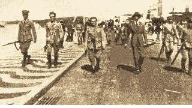

# Prologue - The Beach at Copacabana

> **Label:** dramatized. The 1922 rising, the fort, the beach sortie and
> Prestes's typhoid are historical; the prose, the four groups and the beach
> sequence are a dramatization. The “18” is the legend: the fort held 29, 28
> marched out, and 16 reached the government line. **Tone reference:** Jorge
> Amado, _O Cavaleiro da Esperança_. The prose is original; each page quotation
> is attributed with its edition and page, shown under the page in the English
> and Portuguese text below (complete-books-and-bibliography).

## English

### The Absent One

On the night of 4 July 1922, Luís Carlos Prestes tried to dress for the rising
and collapsed. He had caught typhoid on 13 June, and it kept him in his mother's
house while the conspiracy moved without him. He was a young engineering
officer, second in command of the First Engineer Company at Deodoro, not yet the
name the column would carry. He was not at the Forte de Copacabana, and he was
not on the beach.

The plan had the cadets march from Realengo while Marshal Hermes da Fonseca took
command at Vila Militar. The cadets marched and were fired on; the garrisons did
not rise. By the morning of 6 July only the fort was left. The prologue is
Siqueira Campos's. The column will be Prestes's.

### The Eighteen

The legend gives Siqueira Campos eighteen men and a decision. The record gives
twenty-nine in the fort after its commander was taken prisoner, and twenty-eight
marching out on the afternoon of 6 July. Four slipped away on the avenue.
Sixteen met the government line: eleven held the sidewalk and four took cover in
the pipes of the avenue works.

They fought from the gate up the Avenida Atlântica, past the fishermen's boats
and the works, to the last stretch of sand before Rua Barroso, and the line grew
shorter with every position. Seven rebels were killed or died of their wounds;
the government counted thirty-five killed or wounded. Siqueira Campos, one other
officer and one soldier survived (Macaulay, pp. 26–29). The legend says the
eighteen died there. Both belong to the story.

_Plate: `revolt-1922/press` (see the compendium entry's caption and credit)._

### The Record

The beach did not end the rising; it gave it a date and a myth. The 18 do Forte
became a name for a generation that would try again in São Paulo on 5 July 1924,
in Rio Grande do Sul that October, and in the column. Siqueira Campos carried
the beach with him. Prestes carried the fever, the maps and the name the column
would make.

The column does not begin here. It begins in the south, two years later, with
men who would march out of an encirclement and keep going. But the beach is
where the legend learned to die, and where the campaign learns what a certain
defeat costs.

> The abortive revolt etched July 5 as the origin date of tenentismo, setting into motion further events on the horizon.
>
> — Jacob Blanc, historian
>
> `blanc-2024`, The Prestes Column (Duke, 2024), p. 31

## Português (BR)

### O Ausente

Na noite de 4 de julho de 1922, Luís Carlos Prestes tentou se vestir para o
levante e desabou. Tinha pegado tifo em 13 de junho, e a doença o prendeu na
casa da mãe enquanto a conspiração seguia sem ele. Era um jovem oficial de
engenharia, subcomandante da 1ª Companhia de Engenharia, em Deodoro, ainda não o
nome que a coluna carregaria. Não estava no Forte de Copacabana, e não estava na
praia.

O plano era que os cadetes marchassem do Realengo enquanto o marechal Hermes da
Fonseca assumia o comando na Vila Militar. Os cadetes marcharam e foram
recebidos a tiros; os quartéis não se levantaram. Na manhã de 6 de julho só
restava o forte. O prólogo é de Siqueira Campos. A coluna será de Prestes.

### Os Dezoito

A lenda dá a Siqueira Campos dezoito homens e uma decisão. O registro dá vinte e
nove no forte depois que o comandante foi preso, e vinte e oito saindo em marcha
na tarde de 6 de julho. Quatro se afastaram na avenida. Dezesseis chegaram à
linha do governo: onze seguraram a calçada e quatro se abrigaram nos canos das
obras da avenida.

Lutaram do portão pela Avenida Atlântica, passando pelos barcos dos pescadores e
pelas obras, até o último trecho de areia antes da Rua Barroso, e a linha
encurtava a cada posição. Sete rebeldes morreram em combate ou dos ferimentos; o
governo contou trinta e cinco mortos ou feridos. Siqueira Campos, outro oficial
e um soldado sobreviveram (Macaulay, pp. 26–29). A lenda diz que os dezoito
morreram ali. As duas coisas pertencem à história.

_Plate: `revolt-1922/press` (see the compendium entry's caption and credit)._

### O Registro

A praia não encerrou o levante; deu-lhe uma data e um mito. Os 18 do Forte
viraram o nome de uma geração que tentaria de novo em São Paulo em 5 de julho de
1924, no Rio Grande do Sul em outubro, e na coluna. Siqueira Campos levou a
praia consigo. Prestes levou a febre, os mapas e o nome que a coluna faria.

A coluna não começa aqui. Começa no sul, dois anos depois, com homens que
sairiam marchando de um cerco e continuariam andando. Mas a praia é onde a lenda
aprendeu a morrer, e onde a campanha aprende quanto custa uma derrota certa.

> A revolta fracassada gravou o 5 de julho como a data de origem do tenentismo, pondo em marcha os acontecimentos que viriam.
>
> — Jacob Blanc, historiador
>
> `blanc-2024`, The Prestes Column (Duke, 2024), p. 31. Tradução nossa do inglês.

## Sources and labels

- **Historical:** the 1922 Rio rising; the Forte de Copacabana; the failure of
  the Realengo/Vila Militar plan; the fort's fall on 6 July; the 29 in the fort,
  28 marching, 16 at contact; Siqueira Campos's survival and the seven rebel
  dead; Prestes's typhoid absence.
- **Dramatized:** the four groups of five, five, four and four; the reduction to
  the legendary eighteen; the beach positions; the timing; the prose; the
  interior of the fort.
- **Fictional:** the individual soldiers' personalities and the exact sequence
  of the beach fight.
- **Sources:** `macaulay-1974`, ch. I, pp. 26-29 and ch. II, pp. 37-38;
  `helio-1922` (citation-only); `castro-2022` (tenentismo context, not a Forte
  narrative); `amado-1942` (tone only).
- **Rights:** no Amado text is reproduced. The historical photographs supplied
  for the compendium are period newspaper or document images over 100 years
  old; the project owner determined them public domain on 2026-11-06. See
  [`../compendium/images.md`](../compendium/images.md).

## Use in the campaign

- Read before mission 01 and again in the debrief.
- The short player-facing strings stay in the mission file; this is the
  long-form chapter.
- The column begins in mission 02, in the south. The prologue's dead do not
  carry into the column.

## Images

_EN: The 18 do Forte on the Copacabana beachfront, 1922. Pixel-treated
historical photograph. PT-BR: Os 18 do Forte na orla de Copacabana, 1922. Foto
histórica com tratamento pixel._
