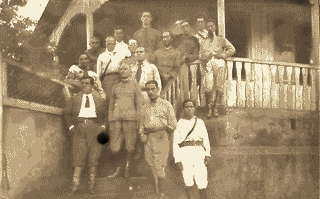
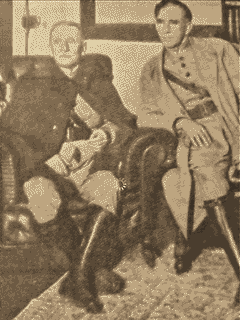

# Foz do Iguaçu

## Short body

**EN:** The political headquarters of the São Paulo revolt at the confluence of
the Iguaçu and Paraná rivers. In April 1925 Prestes and Miguel Costa conferred
with Isidoro here; the division was not formed here. The junction was at Benjamin
Constant, and the division formed at Porto Santa Helena.

**PT-BR:** O quartel-general político da revolta paulista na confluência dos rios
Iguaçu e Paraná. Em abril de 1925, Prestes e Miguel Costa conferenciaram com
Isidoro aqui; a divisão não foi formada aqui. A junção foi em Benjamin Constant,
e a divisão se formou em Porto Santa Helena.

## Extended note

Foz do Iguaçu sits at the confluence of the Iguaçu and Paraná rivers, on the
border with Paraguay and Argentina. In April 1925 it was Isidoro's political
headquarters, not the meeting point of the two forces. Prestes and Miguel Costa
met at Benjamin Constant do Paraná on 3 April; they agreed to combine and move to
Porto Santa Helena, where the First Revolutionary Division was formally organized
on 14 April. They then conferred with Isidoro at Foz.

Macaulay gives about 1,500 men, 600 horses and mules, and three 75 mm guns.
Miguel Costa was the division's formal commander; Prestes was chief of staff and
the column's most visible leader.

The division crossed from Porto Mendes to Puerto Adela: the landing began on 27
April and the crossing was completed on 29 April. Foz do Iguaçu was the
political headquarters, not the junction and not the crossing.

## Nota estendida (PT-BR)

Foz do Iguaçu fica na confluência dos rios Iguaçu e Paraná, na fronteira com o
Paraguai e a Argentina. Em abril de 1925 era o quartel-general político de
Isidoro, não o ponto de encontro das duas forças. Prestes e Miguel Costa se
encontraram em Benjamin Constant do Paraná em 3 de abril; combinaram unir as
forças e seguir para Porto Santa Helena, onde a Primeira Divisão Revolucionária
foi formalmente organizada em 14 de abril. Depois conferenciaram com Isidoro em
Foz.

Macaulay registra cerca de 1.500 homens, 600 cavalos e mulas e três canhões de
75 mm. Miguel Costa era o comandante formal da divisão; Prestes era o chefe do
estado-maior e o líder mais visível da coluna.

A divisão atravessou de Porto Mendes para Puerto Adela: o desembarque começou em
27 de abril e a travessia terminou em 29 de abril. Foz do Iguaçu foi o
quartel-general político, não a junção nem a travessia.

## Design notes

Designer notes kept from the draft; not shown to the player.

Foz do Iguaçu sits at the confluence of the Iguaçu and Paraná rivers, on the
border with Paraguay and Argentina. In April 1925 it was Isidoro’s political
headquarters, not the meeting point of the two forces. Prestes and Miguel Costa
met at Benjamin Constant do Paraná on 3 April; they agreed to combine and move to
Porto Santa Helena, where the First Revolutionary Division was formally organized
on 14 April. They then conferred with Isidoro at Foz.

Macaulay gives about 1,500 men, 600 horses and mules, and three 75-mm guns.
Miguel Costa was the division's formal commander; Prestes was chief of staff and
the column's most visible leader. The campaign must keep both facts visible.

The division crossed from Porto Mendes to Puerto Adela: landing began on 27 April
and the crossing was completed on 29 April. Foz do Iguaçu is therefore the
political headquarters, not the junction and not the crossing. The next entry,
Porto Mendes, is the crossing itself.

## Image slots

| Slot          | Type             | Status    | Rights        | Path                                                               | Alt                                                 | Caption                                                                                                             |
| ------------- | ---------------- | --------- | ------------- | ------------------------------------------------------------------ | --------------------------------------------------- | ------------------------------------------------------------------------------------------------------------------- |
| `hero-photo`  | historical-photo | generated | public-domain | `apps/game/public/assets/compendium/foz-do-iguacu/hero-photo.png`  | Isidoro Dias Lopes and companions at Foz do Iguaçu. | Isidoro Dias Lopes and companions at Foz do Iguaçu, 1924-1925. Pixel-treated historical photograph. Credit pending. |
| `group-photo` | historical-photo | generated | public-domain | `apps/game/public/assets/compendium/foz-do-iguacu/group-photo.png` | Isidoro Dias Lopes and Miguel Costa.                | Isidoro Dias Lopes and Miguel Costa. Pixel-treated historical photograph. Credit pending.                           |

### `hero-photo` source

Source: `FozDoIguacuIsidoro.jpg`, downloaded from Wikimedia Commons (public
domain, unknown author). The Commons title names Batista Luzardo and Isidoro at
Foz do Iguaçu. The source stays in `fotos dos personages/web/` (gitignored).

### `group-photo` source

Source: `IsidoroMiguelCosta.jpg`, downloaded from Wikimedia Commons (public
domain, unknown author). It shows Isidoro Dias Lopes and Miguel Costa. The source
stays in `fotos dos personages/web/` (gitignored).

## Images

_Isidoro Dias Lopes and companions at Foz do Iguaçu, 1924-1925. Pixel-treated
historical photograph. Credit pending._

_Isidoro Dias Lopes and Miguel Costa. Pixel-treated historical photograph. Credit
pending._

## Player captions

| Slot | Caption (EN) | Legenda (PT-BR) | Credit (EN) | Crédito (PT-BR) |
| --- | --- | --- | --- | --- |
| `hero-photo` | Isidoro Dias Lopes and companions at Foz do Iguaçu, 1924–1925. | Isidoro Dias Lopes e companheiros em Foz do Iguaçu, 1924–1925. | Unknown author, via Wikimedia Commons | Autor desconhecido, via Wikimedia Commons |
| `group-photo` | Isidoro Dias Lopes and Miguel Costa. | Isidoro Dias Lopes e Miguel Costa. | Unknown author, via Wikimedia Commons | Autor desconhecido, via Wikimedia Commons |

## Sources

- `macaulay-1974`, ch. III, pp. 86–89 and Foreword: Benjamin Constant, the Foz
  conference, the division and the crossing. Foz was not the junction.
- `castro-2016`: the First Revolutionary Division.
- `blanc-2024`: the interior and the social history of the march.

## Open questions

- The junction was at Benjamin Constant on 3 April 1925; the division formed at
  Porto Santa Helena on 14 April. Macaulay, ch. III, pp. 86–89.
- Foz was Isidoro’s political headquarters; the conference there is not the
  junction.
- How were the two brigades organized under one command?
- Which 1925 photograph of the Foz conference or the division can replace the
  later column image? The current Foz photo is a group portrait, not the
  junction.
