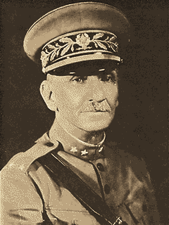

# Isidoro Dias Lopes

## Short body

**EN:** Retired colonel and leader of the July 1924 São Paulo revolt. He led the
rebels' withdrawal toward the interior and the Paraná and commanded the revolt
from Foz do Iguaçu. The remnant met the southern column in western Paraná in
April 1925.

**PT-BR:** Coronel reformado e líder da revolta de São Paulo, em julho de 1924.
Liderou a retirada dos rebeldes para o interior e o Paraná e comandou a revolta
de Foz do Iguaçu. O remanescente encontrou a coluna do sul no oeste do Paraná em
abril de 1925.

## Extended note

Isidoro Dias Lopes was the senior leader of the São Paulo revolt. The rebels took
the city in July 1924, demanded the president's resignation and a provisional
government, and were driven out by legalist forces by the end of the month.
Isidoro led the withdrawal toward the interior and the Paraná and kept his
headquarters at Foz do Iguaçu.

The retreat became the Paraná front. Catanduvas was held by Estilac Leal's
brigade, not by Isidoro in the trenches. The front was lost, but the remnant
survived to meet the southern rebels in western Paraná in April 1925. That
remnant became the São Paulo Brigade of the First Revolutionary Division, under
Miguel Costa's formal command, with Prestes as chief of staff.

In the campaign, Isidoro is the command voice of the Paraná front chapter; the
section in the field serves under Estilac Leal.

## Nota estendida (PT-BR)

Isidoro Dias Lopes foi o principal líder da revolta de São Paulo. Os rebeldes
tomaram a cidade em julho de 1924, exigiram a renúncia do presidente e um governo
provisório, e foram expulsos pelas forças legalistas até o fim do mês. Isidoro
conduziu a retirada para o interior e o Paraná e manteve seu quartel-general em
Foz do Iguaçu.

A retirada virou a frente do Paraná. Catanduvas foi defendida pela brigada de
Estilac Leal, não por Isidoro nas trincheiras. A frente foi perdida, mas o
remanescente sobreviveu para encontrar os rebeldes do sul no oeste do Paraná em
abril de 1925. Esse remanescente tornou-se a Brigada São Paulo da Primeira
Divisão Revolucionária, sob o comando formal de Miguel Costa, com Prestes como
chefe do estado-maior.

Na campanha, Isidoro é a voz de comando do capítulo da frente do Paraná; a seção
em campo serve sob Estilac Leal.

## Design notes

Designer notes kept from the draft; not shown to the player.

Isidoro Dias Lopes was the senior leader of the São Paulo revolt. The rebels took
the city in July 1924, demanded the president's resignation and a provisional
government, and were retaken by legalist forces by the end of the month. Isidoro
led the withdrawal toward the interior and the Paraná and kept his headquarters
at Foz do Iguaçu.

The retreat became the Paraná front. Catanduvas was held by Estilac Leal’s
brigade, not by Isidoro in the trenches. The front was lost, but the remnant
survived to meet the southern rebels in western Paraná in April 1925. That
remnant became the São Paulo Brigade of the First Revolutionary Division, under
Miguel Costa's formal command and Prestes's chief of staff.

The campaign uses Isidoro as the command voice of the Paraná front mission, with
the tactical section under Estilac Leal. He is a proposed new figure: the
documentation registry entry exists, but the runtime registry, source references
and locale entries must be added before the mission can lock.

## Image slots

| Slot       | Type     | Status    | Rights        | Path                                                                 | Alt                       | Caption                                                                        |
| ---------- | -------- | --------- | ------------- | -------------------------------------------------------------------- | ------------------------- | ------------------------------------------------------------------------------ |
| `portrait` | portrait | generated | public-domain | `apps/game/public/assets/compendium/isidoro-dias-lopes/portrait.png` | Isidoro Dias Lopes, 1920. | Isidoro Dias Lopes, 1920. Pixel-treated historical photograph. Credit pending. |

### `portrait` source

Source: `IsidoroDiasLopes1920.jpg`, downloaded from Wikimedia Commons (public
domain, unknown author). It is a single portrait, not the group photos in the
reference folder. The source stays in `fotos dos personages/web/` (gitignored).

## Images

_Isidoro Dias Lopes, 1920. Pixel-treated historical photograph. Credit pending._

## Player captions

| Slot | Caption (EN) | Legenda (PT-BR) | Credit (EN) | Crédito (PT-BR) |
| --- | --- | --- | --- | --- |
| `portrait` | Isidoro Dias Lopes, 1920. | Isidoro Dias Lopes, 1920. | Unknown author, via Wikimedia Commons | Autor desconhecido, via Wikimedia Commons |

## Sources

- `macaulay-1974`, ch. I, pp. 4-6: the São Paulo revolt and Isidoro's role.
- `macaulay-1974`, ch. III, pp. 80-89: Catanduvas, Estilac Leal’s brigade,
  Isidoro at Foz, and the western Paraná combination.
- `castro-2022`: the 1924 São Paulo revolt beyond the tenentes.
- `meirelles-1995`: citation-only.

## Open questions

- Page-level detail: Macaulay, ch. III, pp. 80–89. Isidoro was at Foz; Estilac
  Leal’s brigade held Catanduvas.
- What was his exact rank and title in July 1924 and in 1925?
- Which public-domain portrait is the best source for the image slot?
- When will `isidoro-dias-lopes` be added to `FIGURES.md` and the runtime
  registry?
