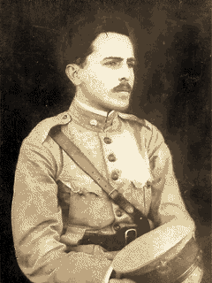
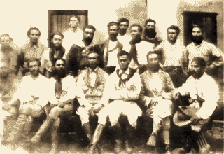

# Luís Carlos Prestes

## Short body

**EN:** Army captain and engineer, chief of staff of the First Revolutionary
Division, and the column’s most visible leader. He was born in Porto Alegre in
1898, missed the 1922 Forte de Copacabana revolt with typhoid, helped lead the
1924 Rio Grande do Sul rising, and marched with the column until the exile of 1927. Miguel Costa was the division’s formal commander; Prestes was the chief of
staff and the face of the march.

**PT-BR:** Capitão e engenheiro do Exército, chefe do estado-maior da 1ª Divisão
Revolucionária e o líder mais visível da coluna. Nasceu em Porto Alegre em 1898,
perdeu a revolta do Forte de Copacabana em 1922 por causa do tifo, ajudou a
liderar o levante gaúcho de 1924 e marchou com a coluna até o exílio de 1927.
Miguel Costa era o comandante formal da divisão; Prestes era o chefe do
estado-maior e o rosto da marcha.

## Extended note

### Before the column

Luís Carlos Prestes was born in Porto Alegre on 3 January 1898, the son of
Antônio Pereira Prestes, an Army engineering officer, and Leocádia Felizardo
Prestes, a primary-school teacher. The family moved between Porto Alegre,
Alegrete and Rio de Janeiro. He entered the Colégio Militar in 1909 and the
Escola Militar do Realengo in 1916, graduating as an engineering officer in 1920.
He served in the 1st Railway Company at Deodoro and later at Santo Ângelo, where
he worked on the Cruz Alta–Porto Lucena railway and a bridge to Camandaí.

In 1922 he was a young captain, not yet the name the column would carry. He
contracted typhoid on 13 June, tried to dress for the rising on the night of 4
July and collapsed. The Forte de Copacabana revolt went forward without him. The
absence is not a footnote: it is why the Prologue belongs to Siqueira Campos, and
the point where Prestes's story separates from the men on the beach.

### The column

Prestes was serving at Santo Ângelo when the state-wide rising began on 28–29
October 1924. He took the local battalion by a ruse, joined the southern rebels
and became the column's chief of staff. He was not the formal commander: Miguel
Costa commanded the First Revolutionary Division, and Prestes commanded the Rio
Grande Brigade, about eight hundred men. The column was not one man.

The march covered roughly 25,000 kilometres through thirteen states. From the
Paraná crossing the column re-entered Brazil in Mato Grosso, marched north
through Goiás and Minas Gerais, crossed the São Francisco, fought in Bahia,
Pernambuco, Piauí and Maranhão, turned back through Minas and Bahia, and finally
moved west toward Mato Grosso and the Bolivian border. The last stage was the
Pantanal crossing. Prestes's authority rested on the march itself: he read the
ground, kept the column moving and avoided the pitched battle the government
wanted. The name "Cavaleiro da Esperança" came after the march, in 1928; it was
a political and literary construction as much as a military reputation. Amado
gives the tone, Macaulay the chronology, and Blanc the interior and the social
cost.

### After the march

In 1927 Prestes crossed into Bolivia and settled at La Gaiba, where he worked for
the Bolivian Concession Limited and tried to find work for the veterans. He did
not join the Communist Party during the march; his conversion came in exile,
after the defeat and the reading that followed it. He later became one of the
central figures of the Brazilian left: the 1935 National Liberation Alliance
rising, years of imprisonment, a Senate seat in 1946–1948, clandestinity after
1948, exile after 1964, and return to Brazil under the 1979 amnesty. He died in
Rio de Janeiro on 7 March 1990.

The later life explains why the march became a founding myth of the Brazilian
left, but it should not be read back into 1925 as if the column were already a
communist project.

### Why he matters

Prestes connects the risings, the march and the memory. He is also the easiest
figure to turn into a superhero. The record keeps the command structure, the
cost and the absences in view: the fever in 1922, Miguel Costa's formal command,
the men who did not come back, and the political uses of the march after 1927.

## Nota estendida (PT-BR)

### Antes da coluna

Luís Carlos Prestes nasceu em Porto Alegre em 3 de janeiro de 1898, filho de
Antônio Pereira Prestes, oficial engenheiro do Exército, e de Leocádia Felizardo
Prestes, professora primária. A família viveu entre Porto Alegre, Alegrete e o
Rio de Janeiro. Ele entrou no Colégio Militar em 1909 e na Escola Militar do
Realengo em 1916, e formou-se oficial engenheiro em 1920. Serviu na 1ª Companhia
Ferroviária em Deodoro e depois em Santo Ângelo, onde trabalhou na ferrovia Cruz
Alta–Porto Lucena e numa ponte para Camandaí.

Em 1922 era um jovem capitão, ainda não o nome que a coluna levaria. Contraiu
tifo em 13 de junho, tentou se vestir para o levante na noite de 4 de julho e
desmaiou. A revolta do Forte de Copacabana seguiu sem ele. A ausência não é um
detalhe: é por isso que o Prólogo pertence a Siqueira Campos, e é o ponto em que
a história de Prestes se separa da dos homens na praia.

### A coluna

Prestes servia em Santo Ângelo quando o levante estadual começou, em 28 e 29 de
outubro de 1924. Tomou o batalhão local com um ardil, juntou-se aos rebeldes do
sul e tornou-se o chefe do estado-maior da coluna. Não era o comandante formal:
Miguel Costa comandava a Primeira Divisão Revolucionária, e Prestes comandava a
Brigada Rio Grande, com cerca de oitocentos homens. A coluna não era um homem
só.

A marcha percorreu cerca de 25 mil quilômetros por treze estados. Depois da
travessia do Paraná, a coluna voltou ao Brasil pelo Mato Grosso, marchou para o
norte por Goiás e Minas Gerais, atravessou o São Francisco, combateu na Bahia,
em Pernambuco, no Piauí e no Maranhão, voltou por Minas e pela Bahia e, por fim,
seguiu para o oeste, rumo ao Mato Grosso e à fronteira boliviana. A última etapa
foi a travessia do Pantanal. A autoridade de Prestes vinha da própria marcha: ele
lia o terreno, mantinha a coluna em movimento e evitava a batalha campal que o
governo queria. O nome "Cavaleiro da Esperança" veio depois da marcha, em 1928;
foi uma construção política e literária tanto quanto uma reputação militar.
Amado dá o tom, Macaulay a cronologia, e Blanc o interior e o custo social.

### Depois da marcha

Em 1927 Prestes atravessou para a Bolívia e se fixou em La Gaiba, onde trabalhou
para a Bolivian Concession Limited e tentou conseguir trabalho para os
veteranos. Não entrou no Partido Comunista durante a marcha; a conversão veio no
exílio, depois da derrota e das leituras que se seguiram. Mais tarde tornou-se
uma das figuras centrais da esquerda brasileira: o levante da Aliança Nacional
Libertadora em 1935, anos de prisão, uma cadeira no Senado em 1946–1948, a
clandestinidade depois de 1948, o exílio depois de 1964 e a volta ao Brasil com
a anistia de 1979. Morreu no Rio de Janeiro em 7 de março de 1990.

A vida posterior explica por que a marcha virou um mito fundador da esquerda
brasileira, mas não deve ser projetada sobre 1925, como se a coluna já fosse um
projeto comunista.

### Por que ele importa

Prestes liga os levantes, a marcha e a memória. É também a figura mais fácil de
transformar em super-herói. O registro mantém à vista a estrutura de comando, o
custo e as ausências: a febre de 1922, o comando formal de Miguel Costa, os
homens que não voltaram e os usos políticos da marcha depois de 1927.

## Design notes

Designer notes kept from the draft; not shown to the player.

#### Before the column

Luís Carlos Prestes was born in Porto Alegre on 3 January 1898, the son of
Antônio Pereira Prestes, an Army engineering officer, and Leocádia Felizardo
Prestes, a primary-school teacher. The family moved between Porto Alegre,
Alegrete and Rio de Janeiro. He entered the Colégio Militar in 1909 and the
Escola Militar do Realengo in 1916, graduating as an engineering officer in 1920. He served in the 1st Railway Company at Deodoro and later at Santo Ângelo,
where he worked on the Cruz Alta–Porto Lucena railway and a bridge to Camandaí.

In 1922 he was a young captain, not yet the name the column would carry. He
contracted typhoid on 13 June, tried to dress for the rising on the night of 4
July and collapsed. The Forte de Copacabana revolt went forward without him.
The absence is not a footnote: it is the reason the Prologue belongs to Siqueira
Campos, and the point where Prestes’s story separates from the men on the beach.

#### The column

Prestes was serving at Santo Ângelo when the state-wide rising began on 28–29
October 1924. He took the local battalion by a ruse, joined the southern rebels,
and became the column’s chief of staff. He was not the formal commander: Miguel
Costa commanded the First Revolutionary Division, and Prestes commanded the Rio
Grande Brigade, about eight hundred men. The campaign must keep that structure
visible; the column was not one man.

The march covered roughly 25,000 kilometers through thirteen states. From the
Paraná crossing the column re-entered Brazil in Mato Grosso, marched north
through Goiás and Minas Gerais, crossed the São Francisco, fought in Bahia,
Pernambuco, Piauí and Maranhão, turned back through Minas and Bahia, and finally
moved west toward Mato Grosso and the Bolivian border. The last stage was the
Pantanal crossing. Prestes’s authority rested on the march itself: he read the
ground, kept the column moving and avoided the pitched battle the government
wanted. The “Cavaleiro da
Esperança” label came after the march, in 1928, but the ground for it was laid
during the column; it was a political and literary construction as much as a
military one. Amado supplies the tone; Macaulay supplies the chronology; Blanc
supplies the interior and the social cost.

#### After the march

In 1927 Prestes crossed into Bolivia and settled at La Gaiba, where he worked for
the Bolivian Concession Limited and tried to find work for the veterans. He did
not join the Communist Party during the march; his conversion came in exile, after
the defeat and the readings that followed it. He later became one of the central
figures of the Brazilian left: the 1935 National Liberation Alliance rising, years
of imprisonment, a Senate seat in 1946–1948, clandestinity after 1948, exile after
1964, and return to Brazil under the 1979 amnesty. He died in Rio de Janeiro on 7
March 1990.

The compendium keeps the later life brief. The campaign is about the column, not
a full biography; the later Prestes explains why the march became a founding myth
of the Brazilian left, but it must not be read back into 1925 as if the column were
already a communist project.

#### Why he matters

Prestes is the campaign’s spine because he connects the risings, the march and the
memory. He is also the easiest figure to turn into a superhero. The game’s answer
is to keep the command structure, the cost and the absences visible: the fever in
1922, Miguel Costa’s formal command, the men who did not come back, and the
political uses of the march after 1927.

## Image slots

| Slot                   | Type             | Status    | Rights        | Path                                                                              | Alt                                                                                                   | Caption                                                                                                    |
| ---------------------- | ---------------- | --------- | ------------- | --------------------------------------------------------------------------------- | ----------------------------------------------------------------------------------------------------- | ---------------------------------------------------------------------------------------------------------- |
| `portrait-1922`        | portrait         | generated | public-domain | `apps/game/public/assets/compendium/luis-carlos-prestes/portrait-1922.png`        | A historical portrait photograph of Luís Carlos Prestes in the early 1920s.                           | Prestes in the early 1920s. Pixel-treated historical photograph. Public domain; credit pending.            |
| `column-photo`         | historical-photo | generated | public-domain | `apps/game/public/assets/compendium/luis-carlos-prestes/column-photo.png`         | The command group of the Prestes Column; Prestes is third seated from the left.                       | Command of the Prestes Column, 1925–1927. Prestes is third seated from the left. Credit: Acervo CPDOC/FGV. |
| `absence-illustration` | illustration     | planned   | CC-BY-4.0     | `apps/game/public/assets/compendium/luis-carlos-prestes/absence-illustration.png` | A young officer's uniform laid out in a dim room, a fever bed and maps on the table, 1922, no people. | The absent one: an original illustration of Prestes's room.                                                |
| `rio-map`              | map              | planned   | CC-BY-4.0     | `apps/game/public/assets/compendium/luis-carlos-prestes/rio-map.png`              | A stylized map of Rio de Janeiro in 1922, showing the fort, Vila Militar, Realengo and the city.      | Rio de Janeiro, 1922: a game map, not a historical survey.                                                 |

### `portrait-1922` source

Source: `luis carlos prestes.jpg`, a period portrait supplied by the project
owner in `fotos dos personages/` (gitignored). The owner determined the period
photographs public domain on 2026-11-06; the specific archive and photographer
are still to be recorded. The image was resized to 240x320 and quantized to the
20-colour sepia palette used by the compendium.

### `column-photo` source

Source: `ComandoColunaPrestes.png`, downloaded from Wikimedia Commons
(`Comando da Coluna Prestes.png`, public domain, Acervo CPDOC/FGV). The Commons
description identifies Luís Prestes as the third seated man from the left. The
image was resized to 320x220 and quantized to the same 20-colour palette.

### `absence-illustration` prompt

Original period illustration, a young officer's uniform laid out on a chair in a
dim room, a fever bed, maps and a lamp on the table, Rio de Janeiro 1922, no
people, muted sepia and olive palette, low-poly/pixel-art treatment, 4:3, no
text.

**Negative:** photorealism, fake historical photo, modern clothing, glamour,
heroic pose, gore, text, watermark.

### `rio-map` prompt

Original stylized map, Rio de Janeiro 1922, the Forte de Copacabana, Vila
Militar, Realengo and the city center, muted sepia and olive palette, pixel-art
treatment, 4:3, no modern labels.

**Negative:** satellite imagery, modern city, online map style, text,
watermark.

## Images

_Prestes in the early 1920s. Pixel-treated historical photograph. Public domain;
credit pending._

_Command of the Prestes Column, 1925–1927. Prestes is third seated from the left.
Credit: Acervo CPDOC/FGV._

## Player captions

| Slot | Caption (EN) | Legenda (PT-BR) | Credit (EN) | Crédito (PT-BR) |
| --- | --- | --- | --- | --- |
| `portrait-1922` | Prestes in the early 1920s. | Prestes no início dos anos 1920. | Unknown author | Autor desconhecido |
| `column-photo` | Command of the Prestes Column, 1925–1927. Prestes is third seated from the left. | Comando da Coluna Prestes, 1925–1927. Prestes é o terceiro sentado, da esquerda para a direita. | Acervo CPDOC/FGV, via Wikimedia Commons | Acervo CPDOC/FGV, via Wikimedia Commons |

## Sources

- `macaulay-1974`, ch. II, pp. 37–38 (typhoid and 1922), and ch. III,
  pp. 86–89 (the division, the Rio Grande Brigade and the chief of staff).
- `cpdoc-prestes`: family background, military formation, 1922–1927 trajectory
  and later political life.
- `blanc-2024`: social and interior history, the memory of the march, and the
  La Gaiba monument.
- `amado-1942`: tone and the “Cavaleiro da Esperança” myth; no text reproduced.
- `anita-1991`: citation-only.
- `docs/history/FIGURES.md`: the registry entry and the command note.

## Open questions

- Which source gives the exact illness timeline at page level? The 13 June date
  comes from Macaulay; the CPDOC biography confirms the typhoid but not the day.
- Which archive and photographer should be credited for the early-1920s
  portrait?
- How much of the post-1927 political life belongs in a compendium entry about
  the march? The current text keeps it brief and cites `cpdoc-prestes`.
- How should the entry describe Miguel Costa's formal command without making
  Prestes the sole subject?
