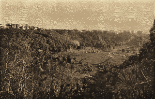
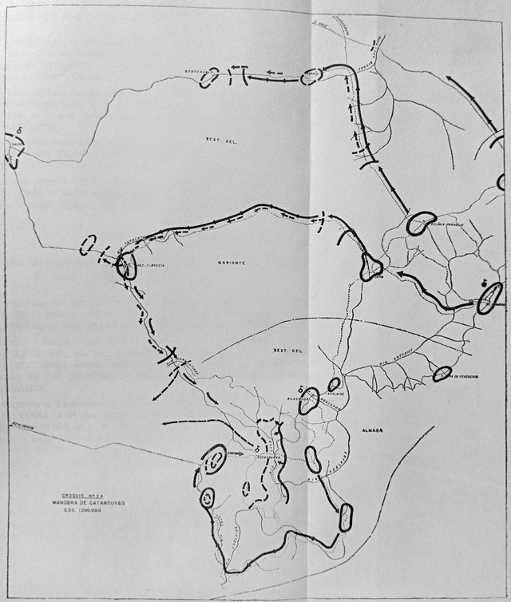

# Fazenda (Paraná front)

## Short body

**EN:** A fictional battlefield in the sourced Paraná front of 1924-1925. The
game map combines the Medeiros hills, Cordeiro's trenches on the Porto Feliz
trail and the Catanduvas campaign. It is a game map, not a historical survey.

**PT-BR:** Um campo de batalha fictício na frente paranaense de 1924-1925. O mapa
do jogo combina as colinas dos Medeiros, as trincheiras de Cordeiro na trilha do
Porto Feliz e a campanha de Catanduvas. É um mapa de jogo, não um levantamento
histórico.

## Extended note

The Paraná front was a series of trench lines in the forest, coffee farms and
farmland of the plateau. The sources describe the Medeiros hills facing
Belarmino, Cordeiro's trenches on the Porto Feliz trail, and the Catanduvas
campaign. The government used artillery, including 105 mm howitzers, against the
stronghold.

The game's Fazenda battlefield is a fictional place in that setting: a coffee and
sugarcane farm with a farmhouse, barn, chapel, trenches, walls, trees and a road.
It is not traced from a historical map, plan or scan.

The battlefield is about the fighting withdrawal: trenches, cover, open fields and
a road to leave by. Its historical setting is the Paraná front; its layout is the
game's.

## Nota estendida (PT-BR)

A frente do Paraná foi uma série de linhas de trincheira na mata, nos cafezais e
nas lavouras do planalto. As fontes descrevem os morros de Medeiros diante de
Belarmino, as trincheiras de Cordeiro na picada de Porto Feliz e a campanha de
Catanduvas. O governo usou artilharia, inclusive obuses de 105 mm, contra a
posição rebelde.

O campo de batalha Fazenda do jogo é um lugar fictício nesse cenário: uma
fazenda de café e cana com casa-sede, paiol, capela, trincheiras, muros, árvores
e uma estrada. Não foi traçado a partir de mapa, planta ou cópia histórica.

O campo de batalha trata da retirada combatendo: trincheiras, abrigo, campo
aberto e uma estrada por onde sair. O cenário histórico é a frente do Paraná; o
traçado é do jogo.

## Design notes

Designer notes kept from the draft; not shown to the player.

The Paraná front was a series of trench lines in the forest, coffee farms and
farmland of the plateau. The sources describe the Medeiros hills facing
Belarmino, Cordeiro's trenches on the Porto Feliz trail, and the Catanduvas
campaign. The government used artillery, including 105-mm howitzers, against the
stronghold.

The game's Fazenda map is a fictional place in that setting: a coffee and
sugarcane farm with a farmhouse, barn, chapel, trenches, walls, trees and a road.
It is not traced from a historical map, plan or scan. The entry should not present
it as a survey of the Paraná front.

The map exists to teach the fighting withdrawal: trenches, cover, open fields and
a road to leave by. Its historical setting is the Paraná front; its layout is the
game's.

## Image slots

| Slot         | Type             | Status    | Rights        | Path                                                            | Alt                                               | Caption                                                                                                                               |
| ------------ | ---------------- | --------- | ------------- | --------------------------------------------------------------- | ------------------------------------------------- | ------------------------------------------------------------------------------------------------------------------------------------- |
| `hero-photo` | historical-photo | generated | public-domain | `apps/game/public/assets/compendium/map-fazenda/hero-photo.png` | View from the rebel trenches at Catanduvas, 1924. | View from the rebel trenches at Catanduvas after the occupation, 1924. Pixel-treated historical photograph. Credit: Thomaz Luiz Reis. |
| `map`        | map              | generated | public-domain | `apps/game/public/assets/compendium/map-fazenda/map.png`        | Croquis 24 - Manobra de Catanduvas (1:200,000).   | Croquis 24 - Manobra de Catanduvas, 1:200,000. Historical map, public domain.                                                         |

### `hero-photo` source

Source: `CatanduvasTrincheiras.jpg`, downloaded from Wikimedia Commons (public
domain, Thomaz Luiz Reis). The caption reads "Vista de Catanduvas do alto das
trincheiras rebeldes depois da ocupação." The source stays in
`fotos dos personages/web/` (gitignored).

### `map` source

Source: `CatanduvasCroquis.jpg`, downloaded from Wikimedia Commons (public
domain, unknown author). It is the historical "Croquis 24 - Manobra de
Catanduvas", scale 1:200,000. Kept in RGB so the labels stay readable.

## Images

_View from the rebel trenches at Catanduvas after the occupation, 1924.
Pixel-treated historical photograph. Credit: Thomaz Luiz Reis._

_Croquis 24 - Manobra de Catanduvas, 1:200,000. Historical map, public domain._

## Player captions

| Slot | Caption (EN) | Legenda (PT-BR) | Credit (EN) | Crédito (PT-BR) |
| --- | --- | --- | --- | --- |
| `hero-photo` | View from the rebel trenches at Catanduvas after the occupation, 1924. | Vista das trincheiras rebeldes em Catanduvas depois da ocupação, 1924. | Thomaz Luiz Reis, via Wikimedia Commons | Thomaz Luiz Reis, via Wikimedia Commons |
| `map` | Croquis 24 – the Catanduvas manoeuvre, 1:200,000. | Croquis 24 – Manobra de Catanduvas, 1:200.000. | Unknown author, via Wikimedia Commons | Autor desconhecido, via Wikimedia Commons |

## Sources

- `macaulay-1974`, ch. III, pp. 71, 82, 85–86: the Medeiros hills, Cordeiro's
  trenches and Catanduvas. Estilac Leal’s brigade held Catanduvas; 407 rebels
  surrendered after Rondon’s 26–29 March 1925 attacks and 105-mm howitzer fire.
- `castro-2022`: the São Paulo revolt and its fronts.

## Open questions

- Page-level detail: Macaulay, ch. III, pp. 71, 82, 85–86.
- Which positions were held by which rebel units? Estilac Leal’s brigade held
  Catanduvas; Cordeiro held the Porto Feliz trail; the exact company positions
  remain open.
- What did the government artillery do to the trenches?
- Which 1924 photograph of the Paraná front or Catanduvas exists?
