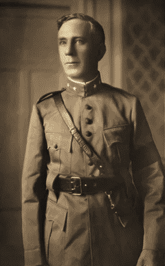

# Miguel Costa

## Short body

**EN:** Miguel Costa was the formal commander of the First Revolutionary
Division. A leader of the São Paulo rebels, he met Prestes at Benjamin Constant
on 3 April 1925 and brought the São Paulo remnant into the division formed at
Porto Santa Helena. Prestes was chief of staff and the column's most visible
leader.

**PT-BR:** Miguel Costa foi o comandante formal da Primeira Divisão
Revolucionária. Líder dos rebeldes paulistas, encontrou Prestes em Benjamin
Constant em 3 de abril de 1925 e levou o remanescente paulista para a divisão
formada em Porto Santa Helena. Prestes era chefe do estado-maior e o líder mais
visível da coluna.

## Extended note

Miguel Costa was the division's formal commander. He came from the São Paulo
revolt of 1924 and brought the São Paulo remnant to the meeting at Benjamin
Constant; the southern and São Paulo forces became the First Revolutionary
Division at Porto Santa Helena on 14 April 1925. Foz do Iguaçu was Isidoro's
political headquarters, not the junction.

Prestes was chief of staff and the column's most visible leader. The column was
not one man, and the command structure was part of the story: Miguel Costa's
formal command corrects a telling of the march that has only Prestes in it.

The division crossed from Porto Mendes to Puerto Adela: the landing began on 27
April and the crossing was completed on 29 April 1925.

## Nota estendida (PT-BR)

Miguel Costa foi o comandante formal da divisão. Veio da revolta de São Paulo de
1924 e levou o remanescente paulista ao encontro em Benjamin Constant; as forças
do sul e de São Paulo tornaram-se a Primeira Divisão Revolucionária em Porto
Santa Helena, em 14 de abril de 1925. Foz do Iguaçu era o quartel-general
político de Isidoro, não o ponto de junção.

Prestes era o chefe do estado-maior e o líder mais visível da coluna. A coluna
não era um homem só, e a estrutura de comando fazia parte da história: o comando
formal de Miguel Costa corrige um relato da marcha em que só Prestes aparece.

A divisão atravessou de Porto Mendes para Puerto Adela: o desembarque começou em
27 de abril e a travessia terminou em 29 de abril de 1925.

## Design notes

Designer notes kept from the draft; not shown to the player.

Miguel Costa was the division's formal commander. He came from the São Paulo
revolt of 1924 and brought the São Paulo remnant to the meeting at Benjamin
Constant; the southern and São Paulo forces became the First Revolutionary
Division at Porto Santa Helena on 14 April 1925. Foz do Iguaçu was Isidoro’s
political headquarters, not the junction.

Prestes was chief of staff and the column's most visible leader. The campaign
must keep both facts: the column was not one man, and the command structure was
part of the story. Miguel Costa's formal command is the corrective to a
Prestes-only narrative.

The division crossed from Porto Mendes to Puerto Adela: landing began on 27 April
and was completed on 29 April 1925. Miguel Costa commanded it formally; Prestes
was chief of staff. The compendium entry should make the command structure
legible without turning the column into a dispute between two men.

## Image slots

| Slot       | Type     | Status    | Rights        | Path                                                           | Alt                      | Caption                                                                       |
| ---------- | -------- | --------- | ------------- | -------------------------------------------------------------- | ------------------------ | ----------------------------------------------------------------------------- |
| `portrait` | portrait | generated | public-domain | `apps/game/public/assets/compendium/miguel-costa/portrait.png` | Miguel Costa in uniform. | Miguel Costa in uniform. Pixel-treated historical photograph. Credit pending. |

### `portrait` source

Source: `miguel costa.webp`, a period portrait supplied by the project owner in
`fotos dos personages/` (gitignored). Public domain by the project owner's
determination; record the archive and credit when known.

## Images

_Miguel Costa in uniform. Pixel-treated historical photograph. Credit pending._

## Player captions

| Slot | Caption (EN) | Legenda (PT-BR) | Credit (EN) | Crédito (PT-BR) |
| --- | --- | --- | --- | --- |
| `portrait` | Miguel Costa in uniform. | Miguel Costa fardado. | Unknown author | Autor desconhecido |

## Sources

- `macaulay-1974`, ch. III, pp. 86–89 and Foreword: the division's formal
  command, Benjamin Constant, Porto Santa Helena and the crossing.
- `castro-2016`: the First Revolutionary Division.
- `blanc-2024`: social and interior history.
- `meirelles-1995`: citation-only.

## Open questions

- Which source gives page-level detail on Miguel Costa's role in April 1925?
- What was his exact rank and title when the division was formed?
- How should the entry describe his relationship with Prestes without reducing
  the column to one man?
- Which public-domain portrait is the best source for the image slot?
- When will `miguel-costa` be added to `FIGURES.md` and the runtime registry?
