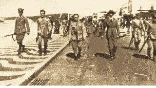
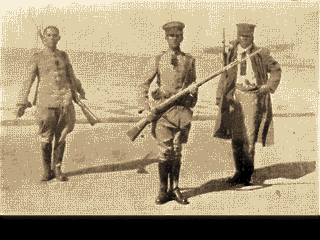

# Revolt of the 18 of the Fort (1922)

## Short body

**EN:** The Rio rising of 5 July 1922 fails. The Realengo cadets are fired on
at Vila Militar; the Forte de Copacabana garrison marches out along the beach
and is destroyed as a fighting force. Siqueira Campos survives; the legend says
the eighteen died there. Prestes, ill with typhoid, is absent.

**PT-BR:** O levante do Rio, em 5 de julho de 1922, fracassa. Os cadetes de
Realengo são recebidos a tiros na Vila Militar; a guarnição do Forte de
Copacabana sai pela praia e é destruída como força de combate. Siqueira Campos
sobrevive; a lenda diz que os dezoito morreram ali. Prestes, doente de tifo,
está ausente.

## Extended note

The 1922 rising was planned as a coordinated movement in Rio: cadets from
Realengo, other garrisons and the Forte de Copacabana. The plan included cutting
the telegraph and telephone lines into the city while the cadets marched and
Marshal Hermes da Fonseca took command at Vila Militar. The cadets were fired on
at Vila Militar; the rising failed elsewhere; government forces overcame the fort
on 6 July.

The fort's garrison did not surrender. The rebels marched out along the beach.
The group became the 18 do Forte, a name that outlived the action. The legend
says all eighteen died on the sand. The record says Siqueira Campos survived.
Both statements belong here: the legend is what the country remembered; the
record is what the sources support.

Prestes was a young engineering officer in 1922. He contracted typhoid on 13
June, tried to dress on the night of 4 July and collapsed. The rising went
forward without him. The failure of 1922 became a founding story for the
generation that would try again in São Paulo and in Rio Grande do Sul in 1924,
and in the column.

## Nota estendida (PT-BR)

O levante de 1922 foi planejado como um movimento coordenado no Rio: cadetes do
Realengo, outras guarnições e o Forte de Copacabana. O plano incluía cortar as
linhas de telégrafo e telefone da cidade enquanto os cadetes marchavam e o
marechal Hermes da Fonseca assumia o comando na Vila Militar. Os cadetes foram
recebidos a tiros na Vila Militar; o levante fracassou nos outros pontos; as
forças do governo dominaram o forte em 6 de julho.

A guarnição do forte não se rendeu. Os rebeldes saíram marchando pela praia. O
grupo virou os 18 do Forte, um nome que sobreviveu à ação. A lenda diz que os
dezoito morreram na areia. O registro diz que Siqueira Campos sobreviveu. As
duas afirmações cabem aqui: a lenda é o que o país lembrou; o registro é o que as
fontes sustentam.

Prestes era um jovem oficial engenheiro em 1922. Contraiu tifo em 13 de junho,
tentou se vestir na noite de 4 de julho e desmaiou. O levante seguiu sem ele. O
fracasso de 1922 tornou-se uma história fundadora para a geração que tentaria
de novo em São Paulo e no Rio Grande do Sul em 1924, e na coluna.

## Design notes

Designer notes kept from the draft; not shown to the player.

The 1922 rising was planned as a coordinated movement in Rio: cadets from
Realengo, other garrisons and the Forte de Copacabana. The plan included cutting
the telegraph and telephone lines into the city while the cadets marched and
Marshal Hermes da Fonseca took command at Vila Militar. The cadets were fired on
at Vila Militar; the rising failed elsewhere; government forces overcame the
fort on 6 July.

The fort's garrison did not surrender. The rebels marched out along the beach.
The group became the 18 do Forte, a name that outlived the action. The legend
says all eighteen died on the sand. The record says Siqueira Campos survived.
The compendium keeps both statements: the legend is what the country
remembered; the record is what the sources support.

Prestes was a young engineering officer in 1922. He contracted typhoid on 13
June, tried to dress on the night of 4 July and collapsed. The rising went
forward without him. The failure of 1922 became a founding story for the
generation that would try again in São Paulo in 1924, in Rio Grande do Sul in
1924, and in the column. The prologue is Siqueira Campos's; the column is
Prestes's.

## Image slots

| Slot                 | Type             | Status    | Rights        | Path                                                                    | Alt                                                                                                                  | Caption                                                                                                                      |
| -------------------- | ---------------- | --------- | ------------- | ----------------------------------------------------------------------- | -------------------------------------------------------------------------------------------------------------------- | ---------------------------------------------------------------------------------------------------------------------------- |
| `hero-photo`         | historical-photo | generated | public-domain | `apps/game/public/assets/compendium/revolt-1922/hero-photo.png`         | Soldiers of the rebel garrison of the Forte de Copacabana, 1922.                                                     | Soldiers of the rebel garrison of the Forte de Copacabana, 1922. Pixel-treated historical photograph. Credit: Zenóbio Couto. |
| `beach-illustration` | historical-photo | generated | public-domain | `apps/game/public/assets/compendium/revolt-1922/beach-illustration.png` | The 18 do Forte marching along the Copacabana beachfront in 1922, rendered as a pixel-treated historical photograph. | The 18 do Forte on the Copacabana beachfront, 1922. Pixel-treated historical photograph. Public domain; credit pending.      |
| `rio-map`            | map              | planned   | CC-BY-4.0     | `apps/game/public/assets/compendium/revolt-1922/rio-map.png`            | A stylized map of Copacabana and the fort in 1922, with the gate, beach road, rocks and government approach.         | Copacabana, 1922: a game map, not a historical survey.                                                                       |

### `hero-photo` source

Source: `PracasGuarnicao.jpg`, downloaded from Wikimedia Commons (public
domain, Zenóbio Couto). The 320x240 image is a palette treatment of the period
photograph; the source stays in `fotos dos personages/web/` (gitignored). The
caption is "Praças da guarnição sublevada do forte de Copacabana."

### `beach-illustration` treatment

The compendium image is a pixel-treated historical photograph, not an original
illustration. The source photo is
`fotos dos personages/18 do forte de copacabana.webp` (gitignored, supplied by
the project owner). The treatment is a 320x180 indexed Aseprite sprite with a
20-colour sepia palette and Bayer 4x4 dithering; the editable source is
`art-src/compendium/18-do-forte-1922.aseprite`.

Rights: public domain. The source is a period newspaper or document image over
100 years old, as determined by the project owner on 2026-11-06. Record the
specific archive, author when known, catalogue number and credit line when
available. Do not present a generated image as this photograph.

### `rio-map` prompt

Original stylized map, Rio de Janeiro 1922, Copacabana beach and fort, fort
gate, beach road, rocks, government approach from the city, four retreat
positions marked, muted sepia and olive palette, pixel-art treatment, 4:3, no
modern labels.

**Negative:** satellite imagery, modern city, online map style, text,
watermark.

## Images

_The 18 do Forte on the Copacabana beachfront, 1922. Pixel-treated historical
photograph. Public domain; specific archive credit pending._

_Soldiers of the rebel garrison of the Forte de Copacabana, 1922. Pixel-treated
historical photograph. Credit: Zenóbio Couto._

## Player captions

| Slot | Caption (EN) | Legenda (PT-BR) | Credit (EN) | Crédito (PT-BR) |
| --- | --- | --- | --- | --- |
| `hero-photo` | Soldiers of the rebel garrison of the Forte de Copacabana, 1922. | Soldados da guarnição rebelde do Forte de Copacabana, 1922. | Zenóbio Couto, via Wikimedia Commons | Zenóbio Couto, via Wikimedia Commons |
| `beach-illustration` | The 18 do Forte on the Copacabana beachfront, 1922. | Os 18 do Forte na orla de Copacabana, 1922. | Unknown author | Autor desconhecido |

## Sources

- `macaulay-1974`, ch. I, pp. 26-29: the fort, the 29/28/16 sortie and the
  beach fight.
- `macaulay-1974`, ch. II, pp. 37-38: the 1922 conspiracy and Prestes's typhoid.
- `helio-1922`: citation-only; the dedicated Forte narrative still needs
  page-level notes.
- `castro-2022`: tenentismo context, not a Forte narrative.
- `amado-1942`: tone only; no text reproduced.

## Open questions

- The beach route and final positions are sourced to Macaulay, ch. I, pp. 26-29;
  exact house numbers and minute-by-minute timing remain open.
- The survival question is answered: Siqueira Campos, one other officer and one
  enlisted man survived; seven rebels died. The legend says all eighteen died.
- What were the government's exact numbers and composition on the beach?
- Did the fort have artillery or naval support, and how should the compendium
  describe it without a playable system?
