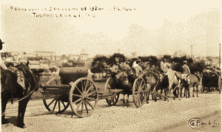

# The São Paulo revolt (1924)

## Short body

**EN:** The São Paulo revolt begins on 5 July 1924 under retired colonel Isidoro
Dias Lopes. Legalist forces retake the city by late July; the rebels withdraw
toward the interior and the Paraná. Their remnant meets the southern column in
western Paraná in April 1925; the division forms at Porto Santa Helena.

**PT-BR:** A revolta de São Paulo começa em 5 de julho de 1924, sob o coronel
reformado Isidoro Dias Lopes. As forças legalistas retomam a cidade no fim de
julho; os rebeldes recuam para o interior e o Paraná. O remanescente encontra a
coluna do sul no oeste do Paraná em abril de 1925; a divisão se forma em Porto
Santa Helena.

## Extended note

The São Paulo revolt was a separate front from the southern rising. It took the
city in July 1924, demanded the president's resignation and a provisional
government, and was driven out by legalist forces by the end of the month. The
rebels withdrew toward the interior and the Paraná.

The retreat became the Paraná front: trenches in the forest and farmland, a
government with artillery, and a rebel force trying to save its men. The front
was lost, but the remnant survived to meet the southern rebels in western Paraná
in April 1925; the First Revolutionary Division was formed at Porto Santa Helena.

The São Paulo revolt is therefore the origin of the São Paulo Brigade that
crossed the Paraná with Miguel Costa and Prestes. It was a separate front, not a
battle of the column.

## Nota estendida (PT-BR)

A revolta de São Paulo foi uma frente separada do levante do sul. Tomou a cidade
em julho de 1924, exigiu a renúncia do presidente e um governo provisório, e foi
expulsa pelas forças legalistas até o fim do mês. Os rebeldes se retiraram para
o interior e o Paraná.

A retirada virou a frente do Paraná: trincheiras na mata e nas lavouras, um
governo com artilharia e uma força rebelde tentando salvar seus homens. A frente
foi perdida, mas o remanescente sobreviveu para encontrar os rebeldes do sul no
oeste do Paraná em abril de 1925; a Primeira Divisão Revolucionária formou-se em
Porto Santa Helena.

A revolta de São Paulo é, portanto, a origem da Brigada São Paulo que atravessou
o Paraná com Miguel Costa e Prestes. Foi uma frente separada, não uma batalha da
coluna.

## Design notes

Designer notes kept from the draft; not shown to the player.

The São Paulo revolt was a separate front from the southern rising. It took the
city in July 1924, demanded the president's resignation and a provisional
government, and was retaken by legalist forces by the end of the month. The
rebels withdrew toward the interior and the Paraná.

The retreat became the Paraná front: trenches in the forest and farmland, a
government with artillery, and a rebel force trying to save its men. The front
was lost, but the remnant survived to meet the southern rebels in western Paraná
in April 1925; the First Revolutionary Division was formed at Porto Santa Helena.

The São Paulo revolt is therefore the origin of the São Paulo Brigade that
crosses the Paraná with Miguel Costa and Prestes. It is a separate front, not a
column battle, and the campaign must keep that distinction.

## Image slots

| Slot         | Type             | Status    | Rights        | Path                                                               | Alt                                 | Caption                                                                                           |
| ------------ | ---------------- | --------- | ------------- | ------------------------------------------------------------------ | ----------------------------------- | ------------------------------------------------------------------------------------------------- |
| `hero-photo` | historical-photo | generated | public-domain | `apps/game/public/assets/compendium/sao-paulo-1924/hero-photo.png` | Legalist troops in São Paulo, 1924. | Legalist troops in São Paulo, 1924. Pixel-treated historical photograph. Credit: Gustavo Prugner. |

### `hero-photo` source

Source: `SaoPaulo1924Tropas.jpg`, downloaded from Wikimedia Commons (public
domain, Gustavo Prugner). The photograph is captioned "Revolução de 5 de Julho
de 1924 - S. Paulo - Tropas legalistas". It shows the legalist side, not the
rebels; the caption makes that clear. The source stays in
`fotos dos personages/web/` (gitignored).

## Images

_Legalist troops in São Paulo, 1924. Pixel-treated historical photograph. Credit:
Gustavo Prugner._

## Player captions

| Slot | Caption (EN) | Legenda (PT-BR) | Credit (EN) | Crédito (PT-BR) |
| --- | --- | --- | --- | --- |
| `hero-photo` | Legalist troops in São Paulo, 1924. | Tropas legalistas em São Paulo, 1924. | Gustavo Prugner, via Wikimedia Commons | Gustavo Prugner, via Wikimedia Commons |

## Sources

- `macaulay-1974`, ch. I, pp. 4-6: the São Paulo revolt and the withdrawal.
- `castro-2022`: the 1924 São Paulo revolt beyond the tenentes.
- `cohen-2007`: the bombardment and the districts hit (Mooca, Brás, Cambuci,
  Belenzinho, Ipiranga, Penha, Perdizes, Sé).
- `blanc-2024`: social and interior history.

## Open questions

- Which source gives page-level detail for the July 1924 revolt and the
  withdrawal?
- What was Isidoro Dias Lopes's exact role at the Paraná front?
- Which 1924 photograph of the city, the rebels or the front can replace the
  group portrait?
