# Compendium Image Manifest

This is the working list of historical-photo, illustration and map slots for
the compendium. Each slot has a home in an entry file; this file tracks the
status, rights and next action across the set.

## Rules

- `research-needed` means a historical photo must be found and its rights
  verified. Do not generate a fake historical photograph.
- `planned` means an original illustration or map is designed but not yet
  generated or commissioned.
- `CC-BY-4.0` is the default for original project illustrations.
- `public-domain-verify` means the image is not cleared until the institution,
  author, catalogue number, source URL and licence are recorded.
- No slot ships until `docs/assets.md` registers it.
- Prompts and research briefs live in the entry files.

## Rights basis

The historical photographs supplied in `fotos dos personages/` are period
newspaper or document images over 100 years old. The project owner determined
them public domain on 2026-11-06. Use `public-domain` for those images and
record the specific archive and credit when known. `public-domain-verify`
remains for images not yet chosen.

## Available source photos

The `fotos dos personages/` folder is gitignored. These are the supplied
period images and the slots they can fill. The folder is not a licence record;
the project owner determined the period photographs public domain on
2026-11-06.

| File                                  | What it shows                                               | Candidate slots                                                                         | Notes                                                                                                                                                                                                                                                 |
| ------------------------------------- | ----------------------------------------------------------- | --------------------------------------------------------------------------------------- | ----------------------------------------------------------------------------------------------------------------------------------------------------------------------------------------------------------------------------------------------------- |
| `18 do forte de copacabana.webp`      | The 18 do Forte marching on the Copacabana beachfront       | `revolt-1922/beach-illustration` (done); `revolt-1922/hero-photo` as a wider crop       | The only Copacabana-specific image in the set; already treated at 320x180.                                                                                                                                                                            |
| `forte de copacabana.png`             | Top-down reference map of the march of the 18 in Copacabana | Reference only; `revolt-1922/rio-map` design reference; mission 01 map reference        | Modern infographic supplied by the project owner; rights TBD; not a period photograph. Reference only; not a compendium image and not a shipped asset. The composition panel lists a larger band than the 18; do not treat it as a one-to-one source. |
| `campos_siqueira.jpg`                 | Portrait of Siqueira Campos in civilian clothes             | `siqueira-campos/portrait-1922`                                                         | Period portrait; public domain.                                                                                                                                                                                                                       |
| `luis carlos prestes.jpg`             | Prestes in uniform, early 1920s                             | `luis-carlos-prestes/portrait-1922`; reuse in `prestes-not-at-fort/portrait-1922`       | Generated as `portrait-1922` (240x320, 20-colour sepia); period portrait; public domain; archive and photographer still to record.                                                                                                                    |
| `Luis_carlos_prestes_1935.jpg`        | Prestes in uniform, 1935                                    | A later Prestes portrait or an exile/column entry                                       | Not the 1922 portrait; keep the early-1920s image for the prologue.                                                                                                                                                                                   |
| `coluna-prestes.jpg`                  | Group photograph of the column                              | `luis-carlos-prestes/column-photo`; `ramada-1925/hero-photo`; `porto-mendes/hero-photo` | Period group photo; public domain; the Ramada and Porto Mendes crossings are not identified.                                                                                                                                                          |
| `soldado.png`                         | Barefoot soldier with a rifle on a road                     | `mauser-7mm/hero-photo`; future infantry entry                                          | Shows the rifle in the field; identity and credit unknown.                                                                                                                                                                                            |
| `miguel costa.webp`                   | Portrait of Miguel Costa in uniform                         | `miguel-costa/portrait`; mission 03                                                     | Generated as `miguel-costa/portrait`; needs a `FIGURES.md` entry before a mission or codex page can lock.                                                                                                                                             |
| `artur bernardes.jpg`                 | Portrait of Artur Bernardes                                 | Future 1924 São Paulo context                                                           | Not the 1922 prologue; not a registered figure.                                                                                                                                                                                                       |
| `dias lopes.png`                      | Group of officers and soldiers on steps                     | Reference only                                                                          | Not 1922; group photo, not a single portrait. The generated portrait uses `IsidoroDiasLopes1920.jpg`.                                                                                                                                                 |
| `general dias lopes.png`              | Group on a railcar                                          | Reference only                                                                          | Not 1922; group photo, not a single portrait. Not used for the generated portrait.                                                                                                                                                                    |
| `osvaldo cordeiro.png`                | Bearded man in rough clothes                                | Future character entry                                                                  | Identity and source still to confirm; not 1922.                                                                                                                                                                                                       |
| `foto menu principal.webp`            | Military parade or formation in a city square               | Already the menu hero; possible 1920s army context                                      | Already registered; avoid duplicating it in the compendium without a clear caption.                                                                                                                                                                   |
| `coluna portinari.jpeg`               | Portinari painting of the column                            | None for now                                                                            | Not a period photograph; artwork copyright likely. Do not use without a licence.                                                                                                                                                                      |
| `gemini_generated_video_127da09a.mp4` | Generated video                                             | None                                                                                    | Not a historical image; do not use in the compendium.                                                                                                                                                                                                 |

## Web sources

Downloaded from Wikimedia Commons on 2026-11-06 into
`fotos dos personages/web/` (gitignored). All listed files are public domain
or CC0. The Commons page is the source record; copy the credit into the final
caption.

| Local file                     | What it shows                                                                                                    | Commons page                                                                                                                                | Licence / credit                                                | Candidate slots                                                                                                |
| ------------------------------ | ---------------------------------------------------------------------------------------------------------------- | ------------------------------------------------------------------------------------------------------------------------------------------- | --------------------------------------------------------------- | -------------------------------------------------------------------------------------------------------------- |
| `ForteCopacabana1922.jpg`      | The garrison of the Forte de Copacabana, 1922; the source image carries a CPDOC caption bar                      | <https://commons.wikimedia.org/wiki/File:ForteCopacabana1922.JPG>                                                                           | Public domain; CPDOC/RCL foto 001                               | `forte-copacabana/hero-photo`                                                                                  |
| `PracasGuarnicao.jpg`          | Soldiers of the rebel garrison with rifles, sea behind                                                           | <https://commons.wikimedia.org/wiki/Special:FilePath/Pra%C3%A7as%20da%20guarni%C3%A7%C3%A3o%20sublevada%20do%20forte%20de%20Copacabana.jpg> | Public domain; Zenóbio Couto                                    | `revolt-1922/hero-photo`; `siqueira-campos/beach-illustration` if the caption does not claim an identification |
| `Os18doForte.jpg`              | The 18 marching on the Copacabana beachfront; the same scene as the current beach image, at a larger source size | <https://commons.wikimedia.org/wiki/File:Os_18_do_Forte.jpg>                                                                                | Public domain; Zenóbio Couto / unknown                          | Sharper source for `revolt-1922/beach-illustration`; wide crop for `revolt-1922/hero-photo`                    |
| `Os18doForte2.jpg`             | The group on the beachfront, sea and hills behind                                                                | <https://commons.wikimedia.org/wiki/File:Os_18_do_Forte_(2).jpg>                                                                            | Public domain; unknown                                          | `siqueira-campos/beach-illustration`; second `revolt-1922` image                                               |
| `Os18doForteCropped.jpg`       | Detail of one soldier with a rifle on the wave-patterned promenade                                               | <https://commons.wikimedia.org/wiki/File:Os_18_do_Forte_(cropped).jpg>                                                                      | Public domain; Zenóbio Couto                                    | A new `revolt-1922/soldier-detail` slot                                                                        |
| `RevoltaForteCopacabana.jpg`   | Atmospheric photograph of soldiers on the beachfront                                                             | <https://commons.wikimedia.org/wiki/File:Revolta_do_Forte_de_Copacabana.jpg>                                                                | CC0; unknown                                                    | Alternative `revolt-1922/hero-photo`                                                                           |
| `MapaCopacabana1922.jpg`       | 1922 map of Copacabana, the fort, Leme and Arpoador                                                              | <https://commons.wikimedia.org/wiki/File:Mapa_Copacabana_1922.jpg>                                                                          | Public domain; Serviço Geográfico Militar (original) + own work | `forte-copacabana/fort-plan`; `revolt-1922/rio-map`                                                            |
| `OJornal9Julho1922.jpg`        | The main gate of the Forte de Copacabana occupied by legalist forces, _O Jornal_, 9 July 1922                    | <https://commons.wikimedia.org/wiki/File:O_Jornal_9_de_julho_de_1922.jpg>                                                                   | Public domain; _O Jornal_                                       | `forte-copacabana/gate-photo` (replace the gate illustration)                                                  |
| `ComandoColunaPrestes.png`     | Command group of the column                                                                                      | <https://commons.wikimedia.org/wiki/File:Comando_da_Coluna_Prestes.png>                                                                     | Public domain; Acervo CPDOC/FGV                                 | `luis-carlos-prestes/column-photo`; `sao-luiz-1924/hero-photo`                                                 |
| `ColunaMiguelCostaPrestes.png` | Column leaders, numbered                                                                                         | <https://commons.wikimedia.org/wiki/File:Coluna_Miguel_Costa-Prestes_chefes_revolucion%C3%A1rios.png>                                       | Public domain; unknown                                          | `rs-revolt-1924/hero-photo`; `porto-mendes/hero-photo`; future column / Miguel Costa entry                     |
| `Gazeta6Julho1922.jpg`         | Newspaper clipping of wounded civilians from the Rua Barão de São Félix explosion                                | <https://commons.wikimedia.org/wiki/File:Gazeta_de_Not%C3%ADcias_6_de_julho_de_1922.jpg>                                                    | Public domain; _Gazeta de Notícias_                             | Not the fort; use only in a civilian-impact context                                                            |
| `InauguracaoCasaForte.jpg`     | Later commemoration of the 18 at the Casa do Forte                                                               | <https://commons.wikimedia.org/wiki/File:Inaugura%C3%A7%C3%A3o_da_Casa_Forte_de_Copacabana.jpg>                                             | Public domain; unknown                                          | Memory/commemoration; not 1922                                                                                 |

`coluna portinari.jpeg` remains do-not-use: it is a Portinari painting, not a
period photograph, and the artwork copyright is a separate question.

## Research pass 2026-11-06

Downloaded from Wikimedia Commons into `fotos dos personages/web/` (gitignored)
unless noted. All period photographs and maps below are public domain. The
Commons file name is the source record; copy the credit into the final caption.

| Local file                                  | Commons file                                                                                     | What it shows                                                                              | Credit / licence                     | Candidate slot                                                 | Status    |
| ------------------------------------------- | ------------------------------------------------------------------------------------------------ | ------------------------------------------------------------------------------------------ | ------------------------------------ | -------------------------------------------------------------- | --------- |
| `IsidoroDiasLopes1920.jpg`                  | `Isidoro Dias Lopes 1920.jpg`                                                                    | Isidoro Dias Lopes, single portrait, 1920                                                  | Unknown; public domain               | `isidoro-dias-lopes/portrait`                                  | generated |
| `SaoPaulo1924Tropas.jpg`                    | `Tropas legalistas - Efeitos da revolução em São Paulo (25).jpg`                                 | Legalist troops in São Paulo, 1924                                                         | Gustavo Prugner; public domain       | `sao-paulo-1924/hero-photo`                                    | generated |
| `CatanduvasTrincheiras.jpg`                 | `147 - Vista de Catanduvas do alto das trincheiras rebeldes depois da ocupação.jpg`              | View from the rebel trenches at Catanduvas after the occupation                            | Thomaz Luiz Reis; public domain      | `map-fazenda/hero-photo`                                       | generated |
| `CatanduvasCroquis.jpg`                     | `Croquis 24 - Manobra de Catanduvas.jpg`                                                         | Croquis 24 - Manobra de Catanduvas, 1:200,000                                              | Unknown; public domain               | `map-fazenda/map`                                              | generated |
| `FozDoIguacuIsidoro.jpg`                    | `Batista Luzardo e Isidoro em Foz do Iguaçu.jpg`                                                 | Isidoro Dias Lopes and companions at Foz do Iguaçu                                         | Unknown; public domain               | `foz-do-iguacu/hero-photo`                                     | generated |
| `IsidoroMiguelCosta.jpg`                    | `Isidoro Dias Lopes e Miguel Costa.jpg`                                                          | Isidoro Dias Lopes and Miguel Costa                                                        | Unknown; public domain               | `foz-do-iguacu/group-photo`                                    | generated |
| `miguel costa.webp`                         | local file in `fotos dos personages/`                                                            | Miguel Costa in uniform                                                                    | Unknown; public domain by the owner  | `miguel-costa/portrait`                                        | generated |
| `LaGaibaSatellite.png`                      | `Vista satelital de la laguna La Gaiba Bolivia Brasil.png` (not downloaded; 429)                 | NASA satellite view of Lagoa La Gaiba, modern                                              | NASA; public domain                  | reference for `la-gaiba`                                       | blocked   |
| `LaGaibaMap.jpg`                            | `SE 21-6 La Gaiba, Bolivia; Brazil` (PCL Map Collection; not downloaded)                         | 1994 topographic map of the La Gaiba area, modern                                          | PCL; public domain                   | reference for `la-gaiba`                                       | blocked   |
| `O Malho 1926`                              | `A Columna Prestes (O Malho 25 de setembro de 1926).jpg` (not downloaded; 429)                   | Period magazine cover and political cartoon about the column                               | _O Malho_; public domain             | period press for `serra-nova` or `pantanal`; not a place photo | candidate |
| `BatalhaoPatriotas1926.jpg`                 | `Batalhão de Patriotas para combater a Coluna-Prestes em Boa Vista PE.jpg` (not downloaded; 429) | A volunteer battalion raised against the column in Boa Vista, Pernambuco, 24 December 1926 | Unknown; public domain               | period press/pursuit image; not a place photo                  | candidate |
| `TrajetoColunaMatoGrosso.jpg`               | `Trajeto da Coluna Prestes em Mato Grosso.jpg` (not downloaded; 429)                             | The column's route in Mato Grosso in May and June 1925                                     | Unknown; public domain (Malan, 1977) | `pantanal` map reference; not the 1927 crossing                | candidate |
| `Verdinho 2007`                             | `RIO VERDINHO - panoramio.jpg`                                                                   | Modern photograph of the Rio Verdinho, Goiás                                               | Paulo Roberto; CC BY-SA 3.0          | modern `map-serra-rio` reference; not 1925                     | reference |
| `Verdinho 2012`                             | `Usina no Rio Verdinho, Goias - panoramio.jpg`                                                   | Modern photograph of the Rio Verdinho hydroelectric plant                                  | Paulo Roberto; CC BY-SA 3.0          | modern `map-serra-rio` reference; not 1925                     | reference |
| `Coluna Prestes de São Luiz a Benjamim.png` | `Coluna Prestes de São Luiz a Benjamim.png`                                                      | Modern map of the early column movements from São Luiz to Benjamim                         | User:Serraria; CC BY-SA 4.0          | reference only; not public domain                              | rejected  |

The search for Serra Nova, the Pantanal crossing, the Verdinho bridge and the
1927 La Gaiba arrival did not produce a confirmed public-domain historical
photograph. A modern map or satellite image can fill a separate `map`/reference
slot only if the caption says it is modern; it must not replace the historical
`hero-photo`. The Macaulay frontispiece route map stays in `livros/` and is not
redistributed.

## Historical photos, portraits and plans

| Slot                 | Entry                 | Path                                                                       | What it should show                                | Status          | Rights               | Next action                                          |
| -------------------- | --------------------- | -------------------------------------------------------------------------- | -------------------------------------------------- | --------------- | -------------------- | ---------------------------------------------------- |
| `hero-photo`         | `revolt-1922`         | `apps/game/public/assets/compendium/revolt-1922/hero-photo.png`            | Soldiers of the rebel garrison of the fort, 1922   | generated       | public-domain        | Record the Zenóbio Couto credit (public domain)      |
| `beach-illustration` | `revolt-1922`         | `apps/game/public/assets/compendium/revolt-1922/beach-illustration.png`    | The 18 do Forte on the Copacabana beachfront, 1922 | generated       | public-domain        | Record the specific archive credit (public domain)   |
| `hero-photo`         | `forte-copacabana`    | `apps/game/public/assets/compendium/forte-copacabana/hero-photo.png`       | The garrison of the Forte de Copacabana, 1922      | generated       | public-domain        | Record the CPDOC/RCL credit (public domain)          |
| `fort-plan`          | `forte-copacabana`    | `apps/game/public/assets/compendium/forte-copacabana/fort-plan.png`        | 1922 map of Copacabana and the fort                | generated       | public-domain        | Record the Serviço Geográfico Militar credit         |
| `gate-photo`         | `forte-copacabana`    | `apps/game/public/assets/compendium/forte-copacabana/gate-photo.png`       | The fort gate occupied by legalist forces, 1922    | generated       | public-domain        | Record the _O Jornal_ credit (public domain)         |
| `portrait-1922`      | `siqueira-campos`     | `apps/game/public/assets/compendium/siqueira-campos/portrait-1922.png`     | Siqueira Campos in 1922 or the early 1920s         | research-needed | public-domain-verify | Find a portrait; record credit and licence           |
| `column-photo`       | `siqueira-campos`     | `apps/game/public/assets/compendium/siqueira-campos/column-photo.png`      | Siqueira Campos with the column                    | research-needed | public-domain-verify | Find an archive image; record credit and licence     |
| `portrait-1922`      | `luis-carlos-prestes` | `apps/game/public/assets/compendium/luis-carlos-prestes/portrait-1922.png` | Prestes in the early 1920s                         | generated       | public-domain        | Record the archive and photographer                  |
| `column-photo`       | `luis-carlos-prestes` | `apps/game/public/assets/compendium/luis-carlos-prestes/column-photo.png`  | Command of the column; Prestes third seated        | generated       | public-domain        | Record the CPDOC/FGV credit                          |
| `portrait-1922`      | `prestes-not-at-fort` | `apps/game/public/assets/compendium/luis-carlos-prestes/portrait-1922.png` | Reuse of the Prestes portrait                      | generated       | public-domain        | Reuse the Prestes entry image                        |
| `hero-photo`         | `mauser-7mm`          | `apps/game/public/assets/compendium/mauser-7mm/hero-photo.png`             | A 7 mm Mauser-pattern service rifle                | research-needed | public-domain-verify | Find a museum or archive image                       |
| `ammo-photo`         | `mauser-7mm`          | `apps/game/public/assets/compendium/mauser-7mm/ammo-photo.png`             | 7 mm rifle cartridges and clips                    | research-needed | public-domain-verify | Find a museum or archive image                       |
| `hero-photo`         | `rs-revolt-1924`      | `apps/game/public/assets/compendium/rs-revolt-1924/hero-photo.png`         | Leaders of the column, later in the march          | planned         | public-domain        | Record the Zenóbio/unknown credit; find a 1924 image |
| `hero-photo`         | `sao-luiz-1924`       | `apps/game/public/assets/compendium/sao-luiz-1924/hero-photo.png`          | Command group of the column, later in the march    | planned         | public-domain        | Record the CPDOC/FGV credit; find a 1924 image       |
| `hero-photo`         | `ramada-1925`         | `apps/game/public/assets/compendium/ramada-1925/hero-photo.png`            | The column, 1925-1927                              | planned         | public-domain        | Record the source credit; find a Ramada image        |
| `hero-photo`         | `sao-luiz-gonzaga`    | `apps/game/public/assets/compendium/sao-luiz-gonzaga/hero-photo.png`       | São Luiz Gonzaga or the missions                   | research-needed | public-domain-verify | Find a 1920s photo; record credit and licence        |
| `hero-photo`         | `foz-do-iguacu`       | `apps/game/public/assets/compendium/foz-do-iguacu/hero-photo.png`          | Isidoro and companions at Foz do Iguaçu            | generated       | public-domain        | Record the unknown credit                            |
| `group-photo`        | `foz-do-iguacu`       | `apps/game/public/assets/compendium/foz-do-iguacu/group-photo.png`         | Isidoro Dias Lopes and Miguel Costa                | generated       | public-domain        | Record the unknown credit                            |
| `hero-photo`         | `porto-mendes`        | `apps/game/public/assets/compendium/porto-mendes/hero-photo.png`           | The column, later in the march                     | planned         | public-domain        | Record the source credit; find a crossing image      |
| `portrait`           | `miguel-costa`        | `apps/game/public/assets/compendium/miguel-costa/portrait.png`             | Miguel Costa in uniform                            | generated       | public-domain        | Record the source credit; register the figure        |
| `hero-photo`         | `map-serra-rio`       | `apps/game/public/assets/compendium/map-serra-rio/hero-photo.png`          | The Verdinho bridge or the Goiás river country     | research-needed | public-domain-verify | Find a 1920s photo; record credit and licence        |
| `hero-photo`         | `sao-paulo-1924`      | `apps/game/public/assets/compendium/sao-paulo-1924/hero-photo.png`         | Legalist troops in São Paulo, 1924                 | generated       | public-domain        | Record the Gustavo Prugner credit                    |
| `hero-photo`         | `map-fazenda`         | `apps/game/public/assets/compendium/map-fazenda/hero-photo.png`            | The Catanduvas trenches, 1924                      | generated       | public-domain        | Record the Thomaz Luiz Reis credit                   |
| `map`                | `map-fazenda`         | `apps/game/public/assets/compendium/map-fazenda/map.png`                   | Croquis 24 - Manobra de Catanduvas, 1:200,000      | generated       | public-domain        | Record the unknown credit                            |
| `hero-photo`         | `serra-nova`          | `apps/game/public/assets/compendium/serra-nova/hero-photo.png`             | Serra Nova or the Minas Gerais highlands           | research-needed | public-domain-verify | Find a 1926 photo; record credit and licence         |
| `hero-photo`         | `pantanal`            | `apps/game/public/assets/compendium/pantanal/hero-photo.png`               | The Pantanal or the column's crossing              | research-needed | public-domain-verify | Find a 1927 photo; record credit and licence         |
| `hero-photo`         | `la-gaiba`            | `apps/game/public/assets/compendium/la-gaiba/hero-photo.png`               | La Gaiba, Bolivia, or the exiles' monument         | research-needed | public-domain-verify | Find a 1927 photo; record credit and licence         |
| `map`                | `la-gaiba`            | `apps/game/public/assets/compendium/la-gaiba/map.png`                      | Modern satellite or topographic view of La Gaiba   | research-needed | public-domain        | Retry the NASA/PCL download; label the map modern    |
| `portrait`           | `isidoro-dias-lopes`  | `apps/game/public/assets/compendium/isidoro-dias-lopes/portrait.png`       | Isidoro Dias Lopes, 1920                           | generated       | public-domain        | Record the unknown credit; register the figure       |

## Illustrations and maps

| Slot                    | Entry                 | Path                                                                               | What it should show                                 | Status  | Rights    | Prompt                                                                |
| ----------------------- | --------------------- | ---------------------------------------------------------------------------------- | --------------------------------------------------- | ------- | --------- | --------------------------------------------------------------------- |
| `rio-map`               | `revolt-1922`         | `apps/game/public/assets/compendium/revolt-1922/rio-map.png`                       | Copacabana, the fort and the government approach    | planned | CC-BY-4.0 | [Prompt](entries/revolt-1922.md#rio-map-prompt)                       |
| `original-map`          | `forte-copacabana`    | `apps/game/public/assets/compendium/forte-copacabana/original-map.png`             | The fort and the beach as an original game map      | planned | CC-BY-4.0 | [Prompt](entries/forte-copacabana.md#original-map-prompt)             |
| `beach-illustration`    | `siqueira-campos`     | `apps/game/public/assets/compendium/siqueira-campos/beach-illustration.png`        | Siqueira Campos and the last group on the beach     | planned | CC-BY-4.0 | [Prompt](entries/siqueira-campos.md#beach-illustration-prompt)        |
| `absence-illustration`  | `luis-carlos-prestes` | `apps/game/public/assets/compendium/luis-carlos-prestes/absence-illustration.png`  | The empty uniform, the fever bed and the maps       | planned | CC-BY-4.0 | [Prompt](entries/luis-carlos-prestes.md#absence-illustration-prompt)  |
| `rio-map`               | `luis-carlos-prestes` | `apps/game/public/assets/compendium/luis-carlos-prestes/rio-map.png`               | Rio de Janeiro: the fort, Vila Militar and Realengo | planned | CC-BY-4.0 | [Prompt](entries/luis-carlos-prestes.md#rio-map-prompt)               |
| `timeline-illustration` | `prestes-not-at-fort` | `apps/game/public/assets/compendium/prestes-not-at-fort/timeline-illustration.png` | The 1922 rising as a visual timeline                | planned | CC-BY-4.0 | [Prompt](entries/prestes-not-at-fort.md#timeline-illustration-prompt) |
| `diagram`               | `mauser-7mm`          | `apps/game/public/assets/compendium/mauser-7mm/diagram.png`                        | A profile diagram of a 1920s Mauser-pattern rifle   | planned | CC-BY-4.0 | [Prompt](entries/mauser-7mm.md#diagram-prompt)                        |

## Generation order

1. `siqueira-campos/beach-illustration` - the commander on the beach.
2. `luis-carlos-prestes/absence-illustration` - the absent-one image.
3. `mauser-7mm/diagram` - the weapon page.
4. Maps and the timeline last.

## Reuse

- `prestes-not-at-fort/portrait-1922` reuses
  `luis-carlos-prestes/portrait-1922`.
- Do not duplicate a historical photo into several entries unless the caption
  makes the reuse clear.

## Rights checklist

- [ ] Institution or archive
- [ ] Author, when known
- [ ] Catalogue number or object id
- [ ] Source URL
- [ ] Licence or public-domain basis
- [ ] Credit line for the caption
- [ ] Entry in `docs/assets.md`

## Delivered

- `revolt-1922/beach-illustration`: pixel-treated historical photograph at
  `apps/game/public/assets/compendium/revolt-1922/beach-illustration.png`
  (320x180, 20-colour sepia palette, Bayer 4x4 dithering). Source `.aseprite`:
  `art-src/compendium/18-do-forte-1922.aseprite`. Source photo:
  `fotos dos personages/18 do forte de copacabana.webp` (gitignored; supplied by
  the project owner), a period newspaper or document image over 100 years old.
  Public domain, determined by the project owner on 2026-11-06; the specific
  archive credit is still to be recorded. The ArtCraft vector base was
  discarded.
- `revolt-1922/hero-photo`: 320x240 palette treatment of
  `PracasGuarnicao.jpg`; public domain, Zenóbio Couto. Source in
  `fotos dos personages/web/` (gitignored).
- `forte-copacabana/hero-photo`: 320x240 palette treatment of
  `ForteCopacabana1922.jpg`; public domain, CPDOC/RCL foto 001. The caption bar
  from the source is cropped.
- `forte-copacabana/fort-plan`: 640x480 historical map from
  `MapaCopacabana1922.jpg`; public domain, Serviço Geográfico Militar. Kept in
  RGB with no dithering so the labels stay readable.
- `forte-copacabana/gate-photo`: 320x213 palette treatment of
  `OJornal9Julho1922.jpg`; public domain, _O Jornal_, 9 July 1922. The
  newspaper caption bar is cropped; the gate lettering is kept.
- `luis-carlos-prestes/portrait-1922`: 240x320 palette treatment of
  `luis carlos prestes.jpg`; public domain by the project owner's determination.
  Source supplied in `fotos dos personages/` (gitignored).
- `luis-carlos-prestes/column-photo`: 320x220 palette treatment of
  `ComandoColunaPrestes.png`; public domain, Acervo CPDOC/FGV. Prestes is third
  seated from the left.
- `isidoro-dias-lopes/portrait`: 240x320 palette treatment of
  `IsidoroDiasLopes1920.jpg`; public domain, unknown author. Single portrait,
  not the group photos in the reference folder.
- `sao-paulo-1924/hero-photo`: 320x191 palette treatment of
  `SaoPaulo1924Tropas.jpg`; public domain, Gustavo Prugner. The caption bar is
  cropped; the image shows legalist troops, not the rebels.
- `map-fazenda/hero-photo`: 320x205 palette treatment of
  `CatanduvasTrincheiras.jpg`; public domain, Thomaz Luiz Reis. View from the
  rebel trenches after the occupation.
- `map-fazenda/map`: 640x754 historical croquis from
  `CatanduvasCroquis.jpg`; public domain, unknown author. Kept in RGB so the
  "Croquis 24 - Manobra de Catanduvas" labels stay readable.
- `foz-do-iguacu/hero-photo`: 320x199 palette treatment of
  `FozDoIguacuIsidoro.jpg`; public domain, unknown author. Caption names the
  Foz do Iguaçu group, not the 1925 junction.
- `foz-do-iguacu/group-photo`: 240x320 palette treatment of
  `IsidoroMiguelCosta.jpg`; public domain, unknown author. Isidoro and Miguel
  Costa together.
- `miguel-costa/portrait`: 240x386 palette treatment of `miguel costa.webp`;
  public domain by the project owner's determination. Source supplied in
  `fotos dos personages/` (gitignored).

## Delivered previews

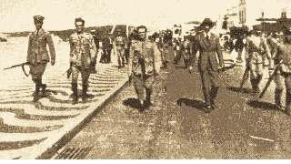

_The 18 do Forte on the Copacabana beachfront, 1922. Pixel-treated historical
photograph. Public domain; specific archive credit pending._

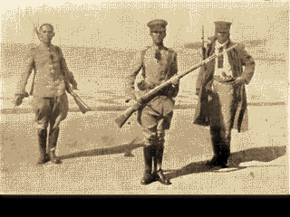

_Soldiers of the rebel garrison of the Forte de Copacabana, 1922. Pixel-treated
historical photograph. Credit: Zenóbio Couto._

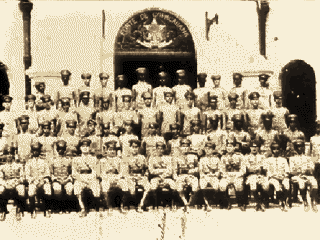

_Garrison of the Forte de Copacabana, 1922. Pixel-treated historical photograph.
Credit: CPDOC/RCL foto 001._

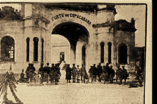

_The main gate of the Forte de Copacabana occupied by legalist forces, *O
Jornal*, 9 July 1922. Pixel-treated historical photograph._

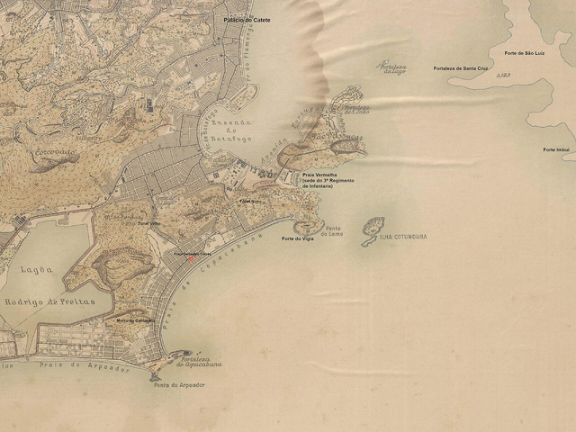

_Map of Copacabana and the fort, 1922. Historical map, Serviço Geográfico
Militar._

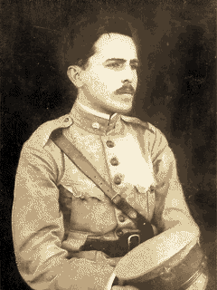

_Prestes in the early 1920s. Pixel-treated historical photograph. Public domain;
credit pending._

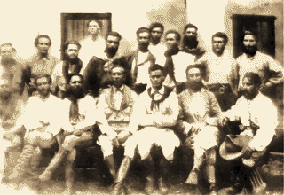

_Command of the Prestes Column, 1925-1927. Prestes is third seated from the left.
Credit: Acervo CPDOC/FGV._

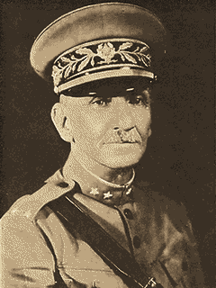

_Isidoro Dias Lopes, 1920. Pixel-treated historical photograph. Public domain;
credit pending._

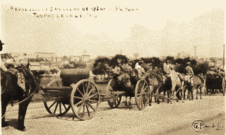

_Legalist troops in São Paulo, 1924. Pixel-treated historical photograph.
Credit: Gustavo Prugner._

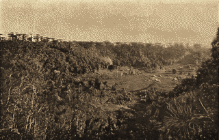

_View from the rebel trenches at Catanduvas after the occupation, 1924.
Pixel-treated historical photograph. Credit: Thomaz Luiz Reis._

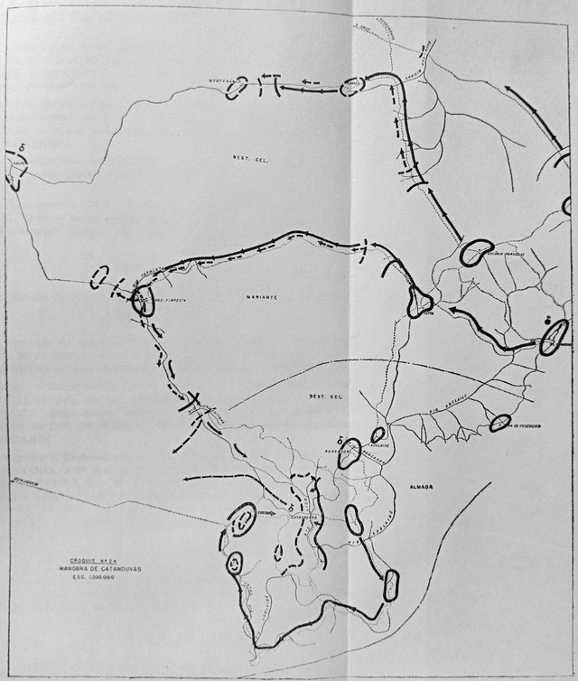

_Croquis 24 - Manobra de Catanduvas, 1:200,000. Historical map, public domain._

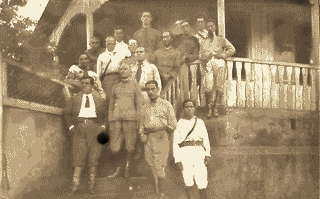

_Isidoro Dias Lopes and companions at Foz do Iguaçu, 1924-1925. Pixel-treated
historical photograph. Public domain; credit pending._

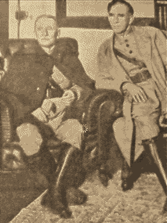

_Isidoro Dias Lopes and Miguel Costa. Pixel-treated historical photograph.
Public domain; credit pending._

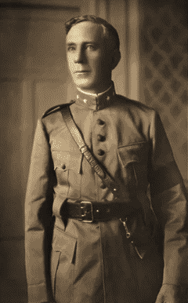

_Miguel Costa in uniform. Pixel-treated historical photograph. Public domain by
the project owner's determination; credit pending._

## What not to do

- Do not generate a historical photograph.
- Do not use a copyrighted image without a licence.
- Do not crop a copyrighted image into a "new" asset.
- Do not ship a placeholder as finished art.
- Do not reproduce book text or a book illustration.
