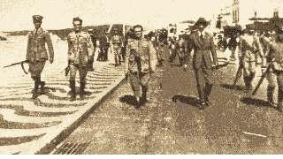
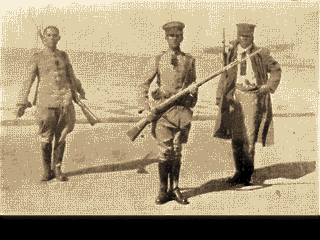

# 01 - Os Dezoito do Forte

## Pitch

The rising has failed. At the Forte de Copacabana, Siqueira Campos has the
legend of the eighteen and one decision: surrender the fort, or march out and
make the government pay for every meter of beach. The mission compresses the
sortie to the legendary eighteen, divided into four groups — five, five, four,
four. Historically the fort held twenty-nine, twenty-eight marched out, and
sixteen reached the government line; the reduction to eighteen is the legend,
not the head count. There is no relief and no victory. The player commands the
four groups through a fighting retreat on the sand, from the gate to the rocks to
the last stretch of beach. Prestes is absent with typhoid. The prologue is
Siqueira's; the column will be Prestes's.

Target length: 15-20 minutes at 1x, in one sitting. The mission is a certain
defeat, not a survival challenge.

## Player text

Shown in the campaign book. Keep it in step with the sections above.

### English

**Place:** Copacabana beach, Rio de Janeiro

**Perspective:** Siqueira Campos, commanding the 18 on the beach; the end is certain.

**Briefing:**

The fort at night. The rising has failed elsewhere; the government is closing
in. Siqueira Campos tells the 18 that there will be no surrender: they will
march out along the beach and make the government pay for every metre. Prestes
is absent with fever. There is no relief and no victory; the task is to hold
each position long enough for the next group to fall back.

**Objectives:**

- Hold the first beach position until the government commits its second section.
- Withdraw the four groups to the rocks in order.
- Make the last stand.

### Português (BR)

**Lugar:** Praia de Copacabana, Rio de Janeiro

**Perspectiva:** Siqueira Campos, no comando dos 18 na praia; o fim é certo.

**Briefing:**

O forte à noite. O levante fracassou nos outros pontos; o governo está
fechando o cerco. Siqueira Campos diz aos 18 que não haverá rendição: eles
sairão marchando pela praia e farão o governo pagar por cada metro. Prestes está
ausente, com febre. Não há reforço nem vitória; a tarefa é manter cada posição o
bastante para o grupo seguinte recuar.

**Objetivos:**

- Manter a primeira posição na praia até o governo empenhar sua segunda seção.
- Recuar os quatro grupos para as pedras, em ordem.
- Resistir até o fim.

## Historical frame

On 5 July 1922 the Rio rising against the federal government began, and the
Forte de Copacabana was one of its centers. The plan included the Realengo
cadets and other garrisons; the cadets were fired on at Vila Militar and the
rising failed elsewhere. The fort held twenty-nine revolutionaries after its
commander was taken prisoner while negotiating; leadership passed to First
Lieutenant Siqueira Campos. On the afternoon of 6 July the rebels marched out
along the beach rather than surrender: twenty-eight left the fort, four deserted
on the avenue, sixteen reached the government line, eleven held the sidewalk and
four took cover in construction pipes. Seven rebels were killed or died of
wounds; Siqueira Campos, one other officer and one enlisted man survived.
Government losses were thirty-five killed or wounded. The group entered the
legend as the 18 do Forte. Prestes, then a young engineering officer, was
bedridden with typhoid and did not take part. The Prologue is played as Siqueira
Campos and the legend of the 18, not as Prestes.

### Sources

| Role       | Source key      | Reference         | Confidence |
| ---------- | --------------- | ----------------- | ---------- |
| Chronology | `macaulay-1974` | ch. I, pp. 26-29  | high       |
| Prestes    | `macaulay-1974` | ch. II, pp. 37-38 | high       |
| Context    | `helio-1922`    | citation-only     | low        |
| Tenentismo | `castro-2022`   | context only      | medium     |
| Tone       | `amado-1942`    | citation-only     | n/a        |

Working note: `docs/history/MACAULAY_NOTES.md`, "1922 - the revolt Prestes
missed". The hour-by-hour sequence of 5-6 July and the fort's internal layout are
still source gaps in `docs/history/CHAPTER_SOURCES.md`. `castro-2022` covers
tenentismo and the 1924 São Paulo revolt; it is context, not a Forte narrative.

### Historical, dramatized, fictional

- **Historical:** the 1922 Rio rising; the Forte de Copacabana as a rebel
  center; the failure of the Realengo/Vila Militar plan; the fort's fall on 6
  July; the rebels marching out along the beach; the 29/28/16 record; Siqueira
  Campos's survival; Prestes's typhoid absence; the cadets fired on at Vila
  Militar.
- **Dramatized:** the four groups of five, five, four and four; the reduction of
  the sortie to the legendary eighteen; the beach positions; the timing of the
  government assaults; the dialogue; the fort interior; the certain-defeat
  framing. The hour-by-hour sequence is a known gap, so the mission is a
  dramatization, not a reconstruction.
- **Fictional:** the identity of the individual soldiers in the four groups and
  the exact patrol schedule. The historical rebels are not represented
  one-to-one in personality or biography; the four groups are the legend as a
  fighting body.
- **Legend versus record:** the defeat screen states the legend ("the 18 are
  dead"). The epilogue states the record (Siqueira Campos and two others
  survived; seven rebels died). The contradiction is deliberate and must stay
  readable.

## Perspective

Siqueira Campos, the commander, not a line unit. The player is his command
voice: four groups, one beach, no relief. The player knows the end is certain;
the mission is about how long the 18 can make the government pay and how the
groups fall back in order. Prestes is the absent future: the codex and the
campaign book explain why the fever that kept him from the beach matters to the
column.

## Player fantasy and pillar

- **Fantasy:** Command the legendary 18 through a fighting retreat on the beach,
  knowing the end is certain, and make the stand cost the government time and
  blood.
- **Pillar:** 1, command the section, not the hero; 3, the march costs more
  than the battle; 4, history with receipts. The mission also teaches pillar 2
  by making the rocks the only cover and the sand the worst ground.
- **Loop beat:** Command -> Sustain -> Decide. The Decide beat is not "how do
  we win" but "where do we make the next stand".

## Objectives

### Primary

- Hold the first beach position until the government commits its second
  section.
- Withdraw the four groups to the rocks in order; at least two groups reach the
  second position.
- Make the last stand; the mission ends when the last line soldier falls.

### Optional

- Hold each position for the target time.
- Inflict more government casualties than the 18 suffer.
- Keep at least one group fighting at the final line.

### Failure

- There is no victory. The historical failure is the outcome: the sortie is
  destroyed as a fighting force. The legend says the 18 died there; the record
  says Siqueira Campos and two others survived.
- A collapse before the final line ends the mission earlier and lowers the
  delay measure; it does not change the ending.
- The mission cannot be "won" by leaving the beach or saving the groups.

## Map and terrain

- Copacabana beach, Rio de Janeiro, afternoon of 6 July 1922, with the fort and
  the approach in the hours before. The map starts at the fort gate and runs
  along the beach to the rocks and the last stretch of sand.
- The sea is a hard boundary on one side; the government comes from the city
  and the fort side. The beach road, the rocks and the sand are the only
  ground.
- Cover: the fort gate, the beach wall, the rocks, the sandbags and the
  scattered beach props. The sand is open and slow; the rocks are the only real
  cover. Height: the government has the inland side; the beach is low.
- The map teaches open-ground danger, rock cover, withdrawal under fire and the
  cost of holding a line that cannot be held. The real fort and beach plan is
  not in the repository; this layout is a game abstraction.

## Images

_The 18 do Forte on the Copacabana beachfront, 1922. Pixel-treated historical
photograph. Public domain; specific archive credit pending._

_Soldiers of the rebel garrison of the Forte de Copacabana, 1922. Pixel-treated
historical photograph. Credit: Zenóbio Couto._

## Forces

| Side   | Sections               | Soldiers | Weapons           | Notes                                                                                          |
| ------ | ---------------------- | -------- | ----------------- | ---------------------------------------------------------------------------------------------- |
| Player | 4: two of 5, two of 4  | 18       | Fuzil Mauser 7 mm | Siqueira Campos is the command voice; the groups are the 18; 5 + 45 draft load                 |
| Enemy  | 5 or more, reinforcing | 30+      | Fuzil Mauser 7 mm | Government infantry; no artillery in play; off-map bombardment is optional and not implemented |

The numbers are a draft balance pass. The player is outnumbered and the ground
is open; the mission must be survivable only as a delay, never as a victory. Do
not tune the government down until the beach is played.

## Mechanics

### Existing

- Section selection, move, advance, attack, suppress, flank, defend, recon, hold
  and aim.
- Directional cover, line of sight, fog of war, morale, suppression, wounds,
  rescue, ammunition and fatigue.
- Fire control (free, on contact, hold) and the ambush setting.
- Pause, speed and the HUD.

### Requires new capability

- Multi-section command: four player groups with independent orders. The
  current game supports one player section.
- Campaign mission scripting: the withdrawal phases, the certain-defeat end,
  the legend-versus-record epilogue and the delay measure are not implemented.
- A beach map and the fort gate as a playable start are new content.
- Campaign book and compendium integration are content, not code; the
  compendium texts are drafts in `docs/campaign/compendium/`.
- Campaign progression is not implemented. The prologue's 18 do not carry into
  the column.

First playable slice: a battle-lab scenario with the beach map, four player
groups (5/5/4/4), government sections and a scripted end when the last player
soldier falls. This proves the multi-section retreat and the certain-defeat
outcome before the campaign wrapper.

## Beats

### Briefing

The fort at night. The rising has failed elsewhere; the government is closing
in. Siqueira Campos tells the 18 that there will be no surrender: they will
march out along the beach and make the government pay for every meter. Prestes
is absent with fever. The four groups are named: five, five, four, four. The
player is told that there is no relief and no victory; the job is to hold each
position long enough for the next group to fall back.

### Opening

The gate opens. The four groups deploy along the beach road. The government
opens fire from the inland side. The player learns the difference between the
rocks and the sand: the rocks stop bullets, the sand only slows men down.

### Mid-mission

The first group is gone. The government brings up a second section. The player
must close the gap, fall back to the rocks and keep the remaining groups in
order. The wounded can be rescued, but every rescue costs time the line does
not have. The sea is behind the groups; there is no flank to turn.

### Climax

The government forms for the last assault. The rocks are lost or nearly lost.
The player must choose the final line: the last stretch of sand, with the sea
behind and no cover ahead. The four groups are down to a handful.

### Last stand

The last group holds the final line. The player fights until the last line
soldier falls. The mission ends with the beach taken and the 18 destroyed.

### Debrief

The beach is quiet. The legend says the 18 died there. The record says Siqueira
Campos survived. Prestes, ill with typhoid, was not there. The column begins in
the south, years later, in mission 02. The debrief is an epilogue, not a victory
screen.

## Texts

- Campaign book chapter: [`../book/01-prologue.md`](../book/01-prologue.md).
- Compendium entries: [`../compendium/README.md`](../compendium/README.md).
- Image and photo placeholders:
  [`../compendium/images.md`](../compendium/images.md).

## Script

| Key                                        | EN (source)                                                                                                                                                                                                                               | PT-BR                                                                                                                                                                                                    |
| ------------------------------------------ | ----------------------------------------------------------------------------------------------------------------------------------------------------------------------------------------------------------------------------------------- | -------------------------------------------------------------------------------------------------------------------------------------------------------------------------------------------------------- |
| `campaign.prologue-18-do-forte.briefing`   | The rising has failed. The fort is surrounded, and we will not surrender it. We go out through the gate, along the beach, and make them pay for every meter. Prestes is down with fever; he will not come. We are eighteen. It is enough. | O levante fracassou. O forte está cercado, e não vamos entregá-lo. Saímos pelo portão, pela praia, e fazemos eles pagarem por cada metro. Prestes está com febre; não virá. Somos dezoito. É o bastante. |
| `campaign.prologue-18-do-forte.opening`    | The gate is open. Four groups: five, five, four, four. Keep the rocks on your left and the sea on your right. Do not stop on the sand.                                                                                                    | O portão está aberto. Quatro grupos: cinco, cinco, quatro, quatro. Mantenham as pedras à esquerda e o mar à direita. Não parem na areia.                                                                 |
| `campaign.prologue-18-do-forte.mid`        | The first group is gone. Close the gap. The rocks are the next line; hold them until the others are through.                                                                                                                              | O primeiro grupo caiu. Fechem o vão. As pedras são a próxima linha; segurem até os outros passarem.                                                                                                      |
| `campaign.prologue-18-do-forte.climax`     | The government is on the sand. There is no relief coming. We hold here. Make every round count.                                                                                                                                           | O governo está na areia. Não vem socorro. Seguramos aqui. Façam cada tiro contar.                                                                                                                        |
| `campaign.prologue-18-do-forte.last-stand` | The groups are down to a handful. The sea is behind us. This is the line. Stay with me.                                                                                                                                                   | Os grupos estão reduzidos a um punhado. O mar está atrás de nós. Esta é a linha. Fiquem comigo.                                                                                                          |
| `campaign.prologue-18-do-forte.defeat`     | The last soldier falls. The beach is taken. The 18 are dead.                                                                                                                                                                              | O último soldado cai. A praia é tomada. Os 18 estão mortos.                                                                                                                                              |
| `campaign.prologue-18-do-forte.epilogue`   | The beach is quiet. The legend says the 18 died there. The record says Siqueira Campos survived. Prestes, ill with typhoid, was not there. The column begins in the south, years later.                                                   | A praia silencia. A lenda diz que os 18 morreram ali. O registro diz que Siqueira Campos sobreviveu. Prestes, doente de tifo, não estava lá. A coluna começa no sul, anos depois.                        |

## Codex unlocks

- Figure: [`siqueira-campos`](../compendium/entries/siqueira-campos.md).
- Figure: [`luis-carlos-prestes`](../compendium/entries/luis-carlos-prestes.md)
  (the absent one; the campaign's spine).
- Place: [`forte-copacabana`](../compendium/entries/forte-copacabana.md).
- Event: [`revolt-1922`](../compendium/entries/revolt-1922.md).
- Weapon: [`mauser-7mm`](../compendium/entries/mauser-7mm.md).

## Outcome

- **No victory.** The mission ends when the last line soldier falls. The
  historical failure is the outcome.
- **Measure:** time held, government casualties and how many groups reached the
  final line. These are the player's score, not survival.
- **Historical outcome:** the 18 are destroyed as a fighting force. The legend
  says all died on the beach; the record says Siqueira Campos survived. Prestes
  was absent with typhoid.
- **Defeat screen:** it states the legend ("the 18 are dead"). The epilogue
  states the record (Siqueira survived). The two lines are deliberately
  different.
- **Retry:** replay to improve the delay. The ending does not change.

## Out of scope

- No victory, extraction, gate timer or fort-interior defense.
- Prestes is not playable; he is the absent spine and the epilogue.
- The city of Rio, the Realengo march, the government chain of command and the
  naval or artillery bombardment.
- Playable artillery, machine guns or a new weapon system.
- Campaign progression, save/load and between-mission UI. The prologue's dead
  do not carry into the column.
- A full historical reconstruction of the fort and the beach; the mission is a
  dramatized slice.

## Open questions

- The beach route and final positions are now sourced to Macaulay, ch. I,
  pp. 26–29: the avenue, the Londres Hotel, the government line at Atlântica and
  Barroso, the sidewalk and the construction pipes. The exact house numbers and
  the minute-by-minute timing remain open.
- The supplied top-down map lists a larger band (a captain, lieutenants,
  sergeants, corporals and soldiers) than the legendary 18. Macaulay gives 29 in
  the fort, 28 marching, 16 at contact; the map may depict that larger band. Do
  not change the four groups without a design decision.
- The survival question is answered: Siqueira Campos, one other officer and one
  enlisted man survived; seven rebels were killed or died of wounds. The legend
  says all eighteen died; the record does not.
- Can four player groups with independent orders be represented without a
  multi-section command capability?
- Can the withdrawal phases, the certain-defeat end and the delay measure be
  represented without campaign mission scripting?
- What were the government's exact numbers and composition on the beach?
  Macaulay gives two platoons, reinforcements and thirty-five killed or wounded;
  the full order of battle is still open.
- What was the fort's exact layout and armament, and did government forces use
  artillery or naval fire? Macaulay mentions the fort's long-range coast
  artillery firing before the sortie; the detailed fort plan is still open.
- The ammunition issue is answered at the level of the sortie: Macaulay says
  each rebel received a shoulder arm and at least two hundred rounds. The
  5 + 45 load is a playability abstraction.
- Does Siqueira exist as a command voice only, or as a unit? The record says he
  survives; the legend says the 18 died.
- The `check:content` fixture still uses the placeholder mission id `prologue`;
  reconcile it with `prologue-18-do-forte` when the metadata enters
  `packages/content`.
- The campaign book and compendium use original prose in Amado's register. No
  Amado text is reproduced; confirm the policy before any excerpt is proposed.
