# Guia para desenhar os mapas da campanha

> **Status:** guia de produção, não é especificação nem código. Escrito para o
> dono desenhar os oito mapas à mão no editor do jogo. Nada aqui altera
> `packages/`, `apps/` ou o conteúdo executável. Baseado no estado do jogo em
> 2026-11-12. Idioma: PT-BR, a pedido do dono; código e specs seguem em inglês.

Este guia usa o que o jogo já tem: o editor de mapas, os objetos do catálogo, as
paletas, os biomas, as regras de desdobramento e objetivos, e os oito capítulos
da campanha em `docs/campaign/`. Ele não inventa sistemas novos e não promete
mecânicas que ainda não existem.

## Como usar

1. Leia a ficha da missão em `docs/campaign/missions/` e o capítulo em
   `docs/campaign/book/`.
2. Escolha o croqui da missão neste guia. Ele é esquemático: serve para decidir
   as grandes massas, não para copiar medidas.
3. Abra o editor (`editor.html` ou o teodolito na mesa do menu).
4. Preencha a ficha técnica da missão (vaga, tamanho, paleta, luz, norte, nota
   de fonte).
5. Desenhe na ordem do guia: massas de terreno → água → estradas → construções →
   cobertura → vegetação → desdobramento → objetivos.
6. Rode **Verificar mapa**. Corrija erros; leia os avisos.
7. Teste no editor. Jogue uma escaramuça 3 vs 3 no mapa e observe o que o mapa
   ensina.
8. Salve no projeto (no servidor de desenvolvimento), gere a miniatura e
   commite o `.map.json` quando o mapa estiver aprovado.

O croqui não substitui o editor. A distância real, a altura e a cobertura só
aparecem nas vistas **Vista de cima**, **Relevo**, **Curvas** e **Cobertura**.

## O que o editor já faz

### Tamanhos e desdobramento

- Tamanhos quadrados: **240 m** (pequeno), **400 m** (médio) e **640 m** (grande).
- Cada lado tem **3 seções**. A área de desdobramento é um polígono; o jogo
  deriva os três pontos de início da área, na linha a 1/5, 1/2 e 4/5 da largura e
  um pouco atrás da borda da frente.
- As duas áreas precisam ficar a pelo menos **160 m** entre centros, não podem se
  sobrepor e precisam ser pelo menos **50% caminháveis**.
- Os três pontos de cada lado precisam ter caminho a pé até o outro lado.

### Objetivos

- O objetivo é um círculo de **12 a 30 m** de raio, com uma bandeira dentro.
- Valor de **1 a 3**; dono inicial **ninguém**, **a coluna** ou **os legalistas**.
- A bandeira não pode estar em água funda nem dentro de uma construção. A
  bandeira no telhado da igreja é a exceção prevista.
- O objetivo precisa ser alcançável a pé a partir dos dois desdobramentos e não
  pode se sobrepor a outro.
- Mapas de escaramuça e de teste precisam de **3 a 5 objetivos**; o editor avisa
  se faltarem. Mapas de campanha não são obrigados a ter 3–5, mas este guia
  sugere 3–5 para os mapas que serão jogados como batalha.

### Cobertura

- O editor mostra a cobertura que o jogo realmente usa: ponto verde esconde um
  homem em pé, amarelo um agachado, laranja só um deitado.
- Trincheiras e valas de estrada escondem um homem agachado; muros e pedras
  escondem conforme a altura.
- O eixo entre os desdobramentos não deve ter mais de **60 m** sem cobertura a
  menos de 10 m. O editor mostra isso como **aviso**, não erro.
- Vegetação **oculta**, não protege. Capim, mato e cana escondem; não param bala.

### Água, estradas e estruturas

- Rio, lagoa e vau; ponte e balsa.
- Estradas de terra, picada, calçamento e asfalto; valas de drenagem dos dois
  lados.
- Muros de taipa, pedra e tijolo; cercas de arame, tábua, ripado e cerca viva.
- Trincheira de tiro (degrau e parapeito) e de comunicação; baias de tiro.
- Construções, pedras, árvores, arbustos, postes, coberturas e objetos.
- Plantas só crescem em terra: não em água, ponte, estrada calçada, construção
  ou trincheira. O editor apaga e avisa.

### Luz, norte e cenário

- Hora do dia de **6h a 18h** e direção do sol; é só visual, não muda a batalha.
- Norte verdadeiro no grid, em graus; é só visual e de HUD, não muda a batalha.
- Rótulo de cenário: **campo de treino**, **cenário histórico com lugar
  fictício** ou **lugar histórico reconstituído**.
- Mapa de campanha exige **missão** e **nota de fonte**; cada missão tem um único
  mapa.

## Regras de desenho

### 1. Um mapa, uma lição

Antes de pintar, escreva em uma frase o que o mapa ensina:

- Copacabana: areia aberta é morte; as pedras são a única cobertura.
- Anel de Ferro: segurar uma cidade não é o mesmo que manter uma coluna andando.
- A Divisão: duas brigadas, um comando, uma travessia.
- Frente do Paraná: a frente se perde; os homens passam.
- Verdinho: a ponte é um relógio; o vau é a saída.
- Serra Nova: ceder terreno e manobrar vale mais que segurar a crista.
- Pantanal: a marcha é o inimigo; a cobertura é escassa de propósito.
- La Gaiba: não há batalha; há memória.

Se uma área do mapa não serve à lição, ela é decoração. Corte.

### 2. Eixo de ataque e três faixas

Desenhe o eixo entre os dois desdobramentos e divida-o em três faixas: esquerda,
centro, direita. Cada faixa deve oferecer uma decisão diferente:

- uma rota mais curta e exposta;
- uma rota mais longa e coberta;
- uma rota que ameaça o objetivo pelo flanco.

Não faça três corredores iguais. O jogador precisa escolher.

### 3. Ritmo de cobertura

- Coloque cobertura a cada **40–60 m** no eixo.
- Varie a altura: pedra pequena (só deitado), muro/cerca (agachado), pedra grande
  ou construção (em pé).
- Use valas de estrada e trincheiras como cobertura linear, não como decoração.
- Em campo aberto por desenho (praia, Pantanal), aceite o aviso de 60 m; mas
  ponha uma pedra, um tronco, um carro de boi ou um capim que esconda para o
  jogador não atravessar sem nenhuma decisão.

### 4. Água é portão

- Rio fundo é borda; vau e balsa são passagem.
- Ponte é gargalo e objetivo natural.
- Não pinte água funda onde o jogador precisa andar. Se o mapa tem uma travessia,
  ela precisa ser caminhável para os dois lados.
- Vaus devem ser claros na vista de cima: areia, pedras, água mais clara.

### 5. Relevo é leitura, não parede

- Use elevações de 1–5 m para criar cristas, cortes de estrada e ombros de tiro.
- Evite penhascos que fecham o mapa. O jogo precisa de rotas.
- Use **Relevo** e **Curvas** para ver se a crista esconde o movimento ou se
  apenas fez uma parede.
- A luz do sol modela a serra; uma luz baixa (manhã ou fim de tarde) ajuda a ler
  as faces.

### 6. Construções são objetivos e abrigos

- Uma construção com entrada e pátio vale mais que três caixas.
- Deixe passagens de pelo menos 2 m entre muros de quintal; quintal fechado é
  armadilha de pathfinding.
- Venda, rancho, casa-sede, engenho, armazém, igreja, coreto e estação são
  objetos do catálogo. Use o que a missão pede, não o que é mais bonito.
- Não sobreponha construções. O editor acusa.

### 7. Objetivos contam uma história

- **Valor 3**: o objetivo que decide a batalha (ponte, travessia, igreja).
- **Valor 2**: o objetivo que dá ritmo (cruzamento, fazenda, ilha).
- **Valor 1**: o objetivo que o jogador pode perder sem perder o mapa (saída,
  rancho, depósito).
- Comece com dono **ninguém** na maioria; dê um objetivo inicial a cada lado só
  quando a missão já começa com terreno ocupado.
- Não sobreponha áreas. Não coloque bandeira em água funda, dentro de casa ou
  atrás de um bloqueio sem caminho.

### 8. A nota de fonte é parte do mapa

Todo mapa de campanha precisa de uma nota curta que cite `docs/history/SOURCES.md`.
Use o formato:

```text
Cenário histórico, lugar fictício. <Lugar e data>. <Fonte key>, <capítulo, páginas>.
O traçado é uma abstração de jogo, não uma planta.
```

Exemplo:

```text
Cenário histórico, lugar fictício. Praia de Copacabana, 6 jul. 1922. macaulay-1974,
cap. I, pp. 26-29; mapa de Copacabana de 1922 (domínio público, Serviço Geográfico
Militar). O traçado é uma abstração de jogo.
```

## Receitas de terreno com o conteúdo atual

### Sul e Paraná (paleta `temperate`)

- Chão: `grass`, `dry-grass`, `packed-earth`, `red-earth`, `mud`, `field-soil`.
- Mata: `mata-atlantica` (araucária, peroba, jequitibá, mulungu, manacá,
  palmito, pau-brasil).
- Campo: `dry-grass`, `basic-straw`, `basic-olive`; capim e mato.
- Construções: `farmhouse`, `barn`, `casa-sede`, `engenho`, `rancho`,
  `wattle-house`, `venda`, `church`, `coreto`, `ferry-house`, `warehouse`,
  `depot`.
- Cercas e muros: `board-fence`, `wire-fence`, `taipa-wall`, `brick-wall`.
- Água: rio, vau, balsa, ponte.

### Cerrado (paleta `cerrado`)

- Chão: `cerrado-red-soil`, `cerrado-grass`, `cerrado-litter`, `lajedo`,
  `stone`, `dry-grass`.
- Vegetação: `pequi`, `buriti`, `aroeira`, `barbatimao`, `cagaita`, `ipe`,
  arbustos de cerrado, capim e mato.
- Pedras: `outcrop`, `matacao`, `boulder`, `rock-small`, `lajedo-slab`,
  `stone-pile`.
- Construções: `rancho`, `wattle-house`, `venda`, `chapel`, `ferry-house`.
- Água: rio de cerrado, vau, buriti na margem.

### Caatinga (paleta `caatinga`)

- Chão: `caatinga-soil`, `caatinga-dry-grass`, `lajedo`, `stone`.
- Vegetação: `juazeiro`, `mandacaru`, `xique-xique`, `macambira`, `umbuzeiro`,
  `catingueira`, `jurema-preta`, arbustos de caatinga.
- Construções: casas pequenas, `chapel`, `venda`, `rancho`.
- Use a caatinga só se a missão entrar no Nordeste; a campanha atual vai do Sul
  ao Pantanal, então ela é referência para o futuro, não para os oito mapas.

### Pantanal (sem paleta própria)

O editor não tem paleta `pantanal`. Use `cerrado` ou `temperate` e resolva pelo
chão e pela água:

- Chão: `mud`, `sand`, `grass`, `dry-grass`, `basic-olive`.
- Água: muitos lagos, rios rasos e vaus; água funda como borda.
- Vegetação: `buriti`, `ipe`, arbustos, capim e mato; nada de mata densa.
- Construções: `rancho`, `wattle-house`, `ferry-house`; poucas.
- Cobertura: troncos, carroças, montes de feno, pedras; pouca cobertura dura.

### Cidade (paleta `urban`)

- Chão: `cobbles`, `quintal-floor`, `packed-earth`, `gravel`.
- Construções: `terraced-house`, `terraced-house-wide`, `sobrado`, `church`,
  `factory`, `warehouse`, `coreto`, `venda`, `armazem`, `town-hall`, `school`,
  `market-shed`, `jail`, `telegraph-office`, `railway-station`.
- Muros: `brick-wall`, `taipa-wall`; calçamento e trilho são visuais.
- Objetos: `lamp`, `telegraph-pole`, `barricade`, `cart`, `barrel`, `crate`.

## Fichas das oito missões

Cada ficha traz:

- a vaga e os campos do editor;
- o croqui;
- a leitura do terreno;
- a ordem de desenho;
- objetivos sugeridos;
- cobertura e cuidados;
- referências visuais.

As coordenadas dos objetivos são **aproximadas** e servem para o croqui. No
editor, clique no lugar real e ajuste o raio.

---

## 01 · Os Dezoito do Forte

**Vaga:** Campanha → 01 Os Dezoito do Forte  
**ID do arquivo:** `copacabana-1922`  
**Data:** 6 de julho de 1922, tarde  
**Comandante:** Siqueira Campos  
**Rótulo:** dramatizado

### O que o mapa precisa provar

Areia aberta é o pior terreno; as pedras são a única cobertura real; a retirada
tem que ser feita por grupos, não em debandada. A vitória não existe: o jogador
mede tempo, baixas do governo e quantos grupos chegam à última linha.

### Ficha técnica

| Campo | Sugestão |
| --- | --- |
| Tamanho | Médio (400 m) |
| Paleta | `urban` |
| Chão base | `sand` |
| Nível da água | −1,2 m (mar como água funda) |
| Luz | 15h, sol a oeste (bearing 250) |
| Norte | 0° |
| Cenário | `historical-setting-fictional-place` |
| Codex | `forte-copacabana` |
| Nota de fonte | `macaulay-1974`, cap. I, pp. 26–29; mapa de Copacabana de 1922 (domínio público, Serviço Geográfico Militar). |
| Forças inimigas (opcional) | 2 composições: `infantaria-exercito`; `infantaria-exercito` + `metralhadora-legalista`. |

### Croqui

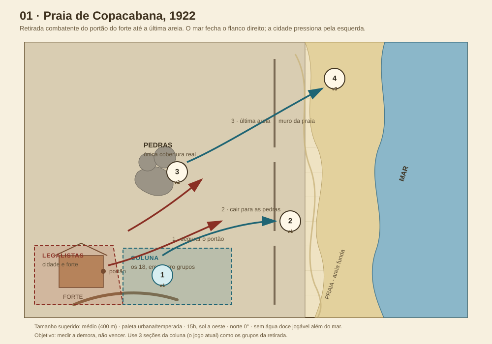

### Leitura do terreno

- **Mar** a leste: água funda, borda dura. O jogador não pode flanquear pelo mar.
- **Cidade e forte** a oeste: o governo pressiona pela esquerda e pelo portão.
- **Praia** no centro: areia, aberta, lenta. É o corredor da retirada.
- **Pedras** no meio: a única cobertura que para bala. Não pinte mata.
- **Muro da praia** a oeste: cobertura linear, com brechas para o mar.
- **Última areia** ao norte: sem cobertura, apenas o fim.

### Ordem de desenho

1. Pinte o mar como água funda na faixa leste; a borda pode ser irregular, mas
   precisa ser intransponível.
2. Pinte a faixa de areia e a cidade/forte a oeste.
3. Coloque o forte (`barracks-block` ou `warehouse` + `brick-wall`) e o portão.
4. Desenhe o muro da praia com brechas; deixe passagens de 3–5 m.
5. Coloque as pedras (`boulder`, `matacao`, `outcrop`) no meio, formando uma
   linha de cobertura, não um labirinto.
6. Espalhe poucos objetos de praia: `fallen-log`, `pebbles`, `sandbags` no
   portão. Nada de árvores.
7. Desenhe as áreas de desdobramento no portão e na cidade.
8. Coloque os objetivos nas quatro posições do croqui.
9. Rode **Verificar mapa**. O aviso de 60 m na areia é esperado; reduza-o com
   pedras e troncos, sem fechar a praia.

### Objetivos sugeridos

| # | PT-BR | EN | Valor | Raio | Dono inicial | Onde |
| --- | --- | --- | --- | --- | --- | --- |
| 1 | Portão do Forte | Fort Gate | 1 | 16 m | A coluna | No portão, junto ao desdobramento |
| 2 | Muro da Praia | Beach Wall | 1 | 18 m | Ninguém | No muro, a 1/3 do caminho |
| 3 | Pedras | Rocks | 2 | 20 m | Ninguém | No centro da linha de pedras |
| 4 | Última Areia | Last Sand | 3 | 22 m | Ninguém | No fim norte da praia |

Os objetivos 2–4 são **medidores de demora** no desenho da missão. Como o jogo
hoje só tem captura e manutenção, o mapa jogado como escaramuça vai tratá-los
como objetivos normais. O final de derrota certa precisa de script de missão,
que ainda não existe.

### Cobertura e cuidados

- Pedras a cada 40–50 m; muro com brechas; sacos de areia no portão.
- Não coloque mata nem capim na areia: a lição é o contraste entre areia e
  pedra.
- O objetivo “Última Areia” não pode ficar na água; deixe a bandeira na areia
  seca.
- Se o mar for água funda, o **Verificar mapa** não deve acusar desdobramento
  dentro dela. Afaste as áreas da borda.

### Referências

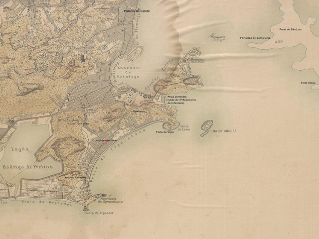

_Mapa de Copacabana e do forte, 1922. Domínio público, Serviço Geográfico
Militar. Use para a relação mar–praia–forte, não para copiar medidas._

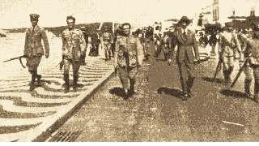

_Os 18 do Forte na praia, 1922. Fotografia histórica tratada; domínio público;
crédito específico pendente._

O arquivo `fotos dos personages/forte de copacabana.png` é um mapa moderno
fornecido pelo dono, só para referência; ele é gitignored e não deve ser
publicado.

---

## 02 · O Anel de Ferro

**Vaga:** Campanha → 02 O Anel de Ferro  
**ID do arquivo:** `sao-luiz-ramada`  
**Data:** dezembro de 1924 a janeiro de 1925  
**Comandante:** Luís Carlos Prestes  
**Rótulo:** dramatizado

### O que o mapa precisa provar

A coluna não segura a cidade: sai, segura Ramada e cruza o Uruguai. O mapa
ensina a diferença entre **guarnecer um lugar** e **manter uma coluna em
movimento**.

### Ficha técnica

| Campo | Sugestão |
| --- | --- |
| Tamanho | Médio (400 m) |
| Paleta | `temperate` |
| Chão base | `dry-grass` |
| Nível da água | −1,2 m |
| Luz | 6h30, sol a leste (bearing 90) |
| Norte | 0° |
| Cenário | `historical-setting-fictional-place` |
| Codex | `sao-luiz-gonzaga` |
| Nota de fonte | `macaulay-1974`, cap. II, pp. 43–48 e p. 61; cap. III, pp. 74–76; `vitor-2011` para geografia local. |
| Forças inimigas (opcional) | `brigada-militar`; `provisorios`; `infantaria-exercito`. |

### Croqui

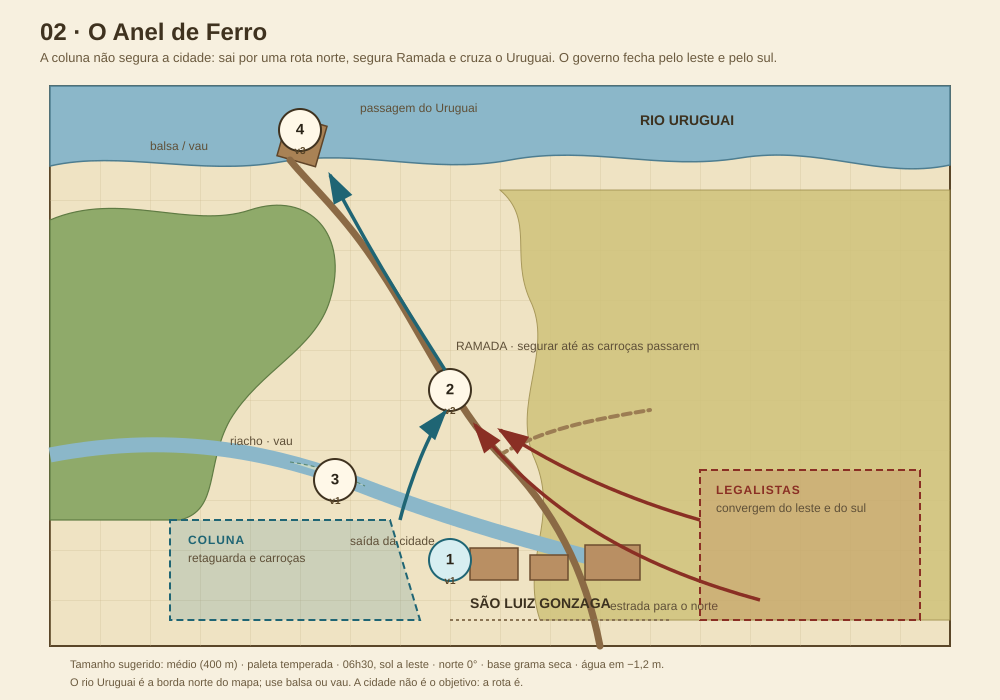

### Leitura do terreno

- **Sul:** São Luiz Gonzaga, a cidade que a coluna deixa. Ruas, casas, cercas.
- **Centro:** Ramada, um cruzamento de estrada com campos e mato.
- **Oeste:** mata e a rota norte; é a saída da coluna.
- **Riacho** diagonal: vau no centro; a margem é cobertura.
- **Norte:** rio Uruguai, a passagem final; balsa ou vau.
- **Leste:** campos abertos; o governo converge por ali.

### Ordem de desenho

1. Pinte os campos a leste e a mata a oeste.
2. Desenhe o rio Uruguai como borda norte; deixe uma balsa e/ou um vau.
3. Desenhe o riacho diagonal e o vau; o vau precisa ser caminhável.
4. Trace a estrada sul–norte, passando por Ramada; dê valas nos trechos retos.
5. Coloque a cidade ao sul: `venda`, `coreto`, `church`, `casa-terrea`,
   `board-fence`; não feche as ruas.
6. Coloque `farmhouse`, `barn`, `rancho` e `engenho` nos campos.
7. Espalhe cobertura: árvores de mata, cercas, carroças, montes de feno,
   troncos, valas.
8. Desenhe o desdobramento da coluna no sudoeste e o legalista no leste/sudeste.
9. Coloque os objetivos: saída da cidade, Ramada, vau, passagem do Uruguai.
10. Verifique caminhos: a coluna precisa conseguir sair e cruzar o rio.

### Objetivos sugeridos

| # | PT-BR | EN | Valor | Raio | Dono inicial | Onde |
| --- | --- | --- | --- | --- | --- | --- |
| 1 | Saída de São Luiz | São Luiz Exit | 1 | 18 m | A coluna | Na estrada, na borda sul |
| 2 | Ramada | Ramada | 2 | 22 m | Ninguém | No cruzamento central |
| 3 | Vau do Riacho | Stream Ford | 1 | 16 m | Ninguém | No vau do riacho |
| 4 | Passagem do Uruguai | Uruguay Crossing | 3 | 18 m | Ninguém | Na balsa/vau norte |

### Cobertura e cuidados

- A estrada é o eixo: valas e cercas a cada 40–60 m.
- Ramada precisa ter cobertura dos dois lados: carroças, cercas, capim.
- Não pinte a mata como parede; deixe clareiras e passagens.
- O vau do riacho e a passagem do Uruguai precisam ser caminháveis para os dois
  lados; se usar balsa, confirme que ela liga as duas margens.
- O objetivo da cidade não deve ficar dentro de uma casa; coloque a bandeira na
  rua ou no largo.

### Referências

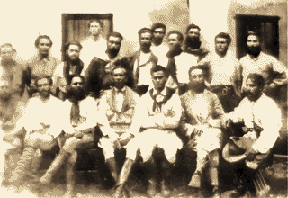

_Comando da Coluna Prestes, 1925–1927. Domínio público, Acervo CPDOC/FGV. Não é
uma foto de Ramada; serve para o tom, não para o terreno._

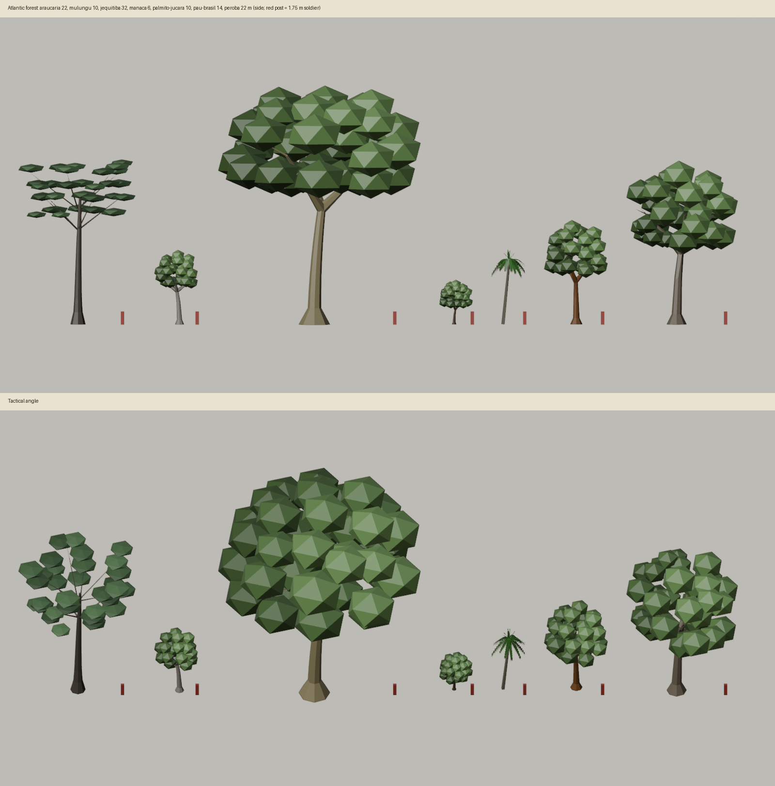

_Referência de vegetação do jogo: borda de mata atlântica. Use a mata como
cobertura e bloqueio de visão, não como floresta fechada._

---

## 03 · A Divisão

**Vaga:** Campanha → 03 A Divisão  
**ID do arquivo:** `porto-mendes`  
**Data:** abril de 1925  
**Comandante:** Miguel Costa  
**Rótulo:** dramatizado

### O que o mapa precisa provar

Duas brigadas, um comando, uma travessia. O rio é o portão; a margem oposta é o
objetivo. O jogador organiza a passagem e segura a margem de trás.

### Ficha técnica

| Campo | Sugestão |
| --- | --- |
| Tamanho | Grande (640 m) |
| Paleta | `temperate` |
| Chão base | `dry-grass` |
| Nível da água | −1,2 m |
| Luz | 7h, sol a leste (bearing 90) |
| Norte | 0° |
| Cenário | `historical-setting-fictional-place` |
| Codex | `porto-mendes` |
| Nota de fonte | `macaulay-1974`, cap. III, pp. 86–89; `castro-2016` para a divisão. |
| Forças inimigas (opcional) | `infantaria-exercito`; `brigada-militar`; `metralhadora-legalista`. |

### Croqui

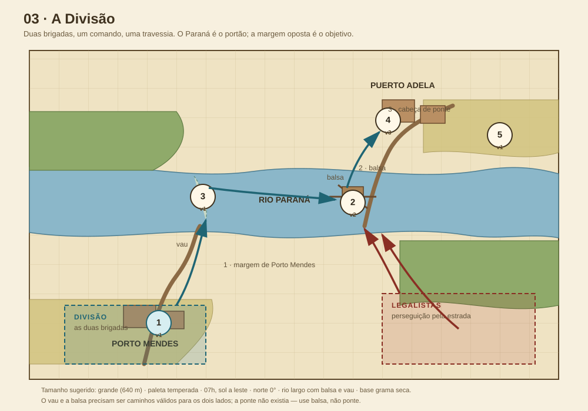

### Leitura do terreno

- **Rio Paraná** no centro: largo, fundo, com balsa e vau.
- **Porto Mendes** na margem próxima: casas, armazém, estrada.
- **Puerto Adela** na margem oposta: cabeça de ponte, estrada, mata.
- **Mata** nas duas margens: cobertura e bloqueio de visão.
- **Estrada** liga os portos e a perseguição.
- **Margem de trás** é o que o jogador segura enquanto a divisão passa.

### Ordem de desenho

1. Pinte o rio largo no centro; margens irregulares, água funda.
2. Desenhe a balsa (duas margens) e o vau; ambos caminháveis.
3. Pinte a mata nas duas margens; deixe clareiras nas cabeças de ponte.
4. Trace a estrada de Porto Mendes à balsa e a estrada de Puerto Adela.
5. Coloque as construções dos portos: `ferry-house`, `warehouse`, `depot`,
   `rancho`, `venda`.
6. Espalhe cobertura: árvores, cercas, caixas, barris, carroças, trincheiras
   rasas na margem.
7. Desenhe a divisão no sudoeste e os legalistas no sudeste.
8. Coloque os objetivos: porto, balsa, vau, cabeça de ponte, estrada.
9. Verifique se os dois desdobramentos alcançam a margem oposta pela balsa/vau.

### Objetivos sugeridos

| # | PT-BR | EN | Valor | Raio | Dono inicial | Onde |
| --- | --- | --- | --- | --- | --- | --- |
| 1 | Porto Mendes | Porto Mendes | 1 | 20 m | A coluna | No porto, margem próxima |
| 2 | Balsa | Ferry | 2 | 18 m | Ninguém | Na balsa |
| 3 | Vau do Paraná | Paraná Ford | 1 | 16 m | Ninguém | No vau |
| 4 | Cabeça de Ponte | Bridgehead | 3 | 22 m | Ninguém | Na margem oposta |
| 5 | Estrada da Divisão | Division Road | 1 | 20 m | Ninguém | Na estrada da margem oposta |

### Cobertura e cuidados

- A margem de trás precisa de cobertura para a retaguarda: trincheiras rasas,
  carroças, caixas, árvores.
- A balsa e o vau são gargalos: não os cubra com vegetação que apague o caminho.
- Não use ponte: a travessia histórica foi por balsa/barco e vau. Se usar ponte
  como abstração, diga na nota de fonte.
- O objetivo da cabeça de ponte não pode ficar dentro da mata fechada; deixe a
  bandeira em clareira ou estrada.
- O mapa é grande: teste o tempo de caminhada. Se a divisão demorar demais,
  aproxime os desdobramentos ou reduza para 400 m.

### Referências

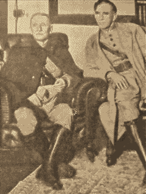

_Isidoro Dias Lopes e Miguel Costa. Domínio público; crédito pendente. Use para
a voz de comando, não para a travessia._


_Referência de mata para as margens do Paraná._

---

## 04 · A Frente do Paraná

**Vaga:** Campanha → 04 A Frente do Paraná  
**ID do arquivo:** `catanduvas`  
**Data:** 1924–1925  
**Comandante:** Isidoro Dias Lopes (voz), seção sob Estilac Leal  
**Rótulo:** dramatizado

### O que o mapa precisa provar

A frente está perdida; a tarefa é evacuar feridos e suprimentos e sair em ordem.
O mapa ensina uma retirada combatente: segurar a trincheira, trocar terreno por
tempo e não transformar a saída em debandada.

### Ficha técnica

| Campo | Sugestão |
| --- | --- |
| Tamanho | Médio (400 m) |
| Paleta | `temperate` |
| Chão base | `field-soil` |
| Nível da água | 0 m (sem água) |
| Luz | 16h, sol a oeste (bearing 250) |
| Norte | 0° |
| Cenário | `historical-setting-fictional-place` |
| Codex | `map-fazenda` |
| Nota de fonte | `macaulay-1974`, cap. III, pp. 80–86; `castro-2022` para o contexto paulista. |
| Forças inimigas (opcional) | `infantaria-exercito`; `voluntarios`; `metralhadora-legalista`. |

### Croqui

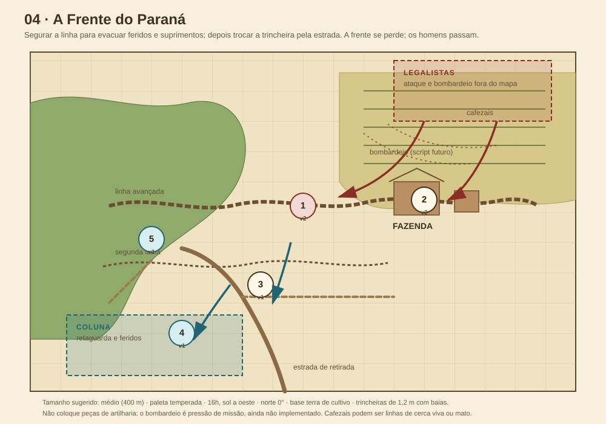

### Leitura do terreno

- **Norte:** o governo ataca; a artilharia é fora do mapa e não jogável.
- **Centro:** linha de trincheiras, com baias de tiro e comunicação.
- **Direita:** fazenda, cafezais, celeiro; a fazenda é abrigo e objetivo.
- **Esquerda:** mata; cobertura e flanco.
- **Sul:** estrada de retirada, depósito e segunda linha.
- **Cafezais:** use cerca viva ou fileiras de arbustos; o catálogo não tem
  “café”.

### Ordem de desenho

1. Pinte a base de terra de cultivo e os campos.
2. Pinte a mata a oeste e os cafezais a nordeste (cerca viva ou arbustos em
   fileiras).
3. Desenhe a linha de trincheiras principal, com baias de tiro, e uma linha de
   comunicação para a fazenda.
4. Desenhe a segunda linha ao sul.
5. Coloque a fazenda (`farmhouse`, `barn`, `casa-sede`), o celeiro, o paiol e a
   cerca.
6. Trace a estrada de retirada e a picada para a fazenda.
7. Espalhe cobertura: trincheiras, muros, cercas de arame, troncos, carroças,
   montes de feno.
8. Desenhe a coluna ao sul e os legalistas ao norte.
9. Coloque os objetivos: trincheira avançada, fazenda, cruzamento, depósito,
   segunda linha.
10. Verifique se a fazenda e a segunda linha têm caminho para os dois lados.

### Objetivos sugeridos

| # | PT-BR | EN | Valor | Raio | Dono inicial | Onde |
| --- | --- | --- | --- | --- | --- | --- |
| 1 | Trincheira Avançada | Forward Trench | 2 | 22 m | Os legalistas | No centro da linha principal |
| 2 | Casa da Fazenda | Farmhouse | 2 | 20 m | Ninguém | No pátio da fazenda |
| 3 | Cruzamento da Estrada | Road Junction | 1 | 18 m | Ninguém | Onde a estrada cruza a picada |
| 4 | Depósito de Suprimentos | Supply Dump | 1 | 18 m | A coluna | No depósito ao sul |
| 5 | Segunda Linha | Second Line | 1 | 20 m | A coluna | Na segunda trincheira |

### Cobertura e cuidados

- A linha de trincheiras é cobertura linear; não a interrompa com construções.
- A fazenda precisa de pátio e portas; não feche o quintal.
- Cafezais são **vegetação que oculta**, não cobertura dura. Use cerca viva
  (`hedgerow`) ou fileiras de arbustos.
- Não coloque artilharia: o bombardeio é script futuro. Se quiser pressão,
  marque na nota de fonte que a artilharia está fora do mapa.
- O objetivo da fazenda não pode ficar dentro da parede; use o pátio.

### Referências

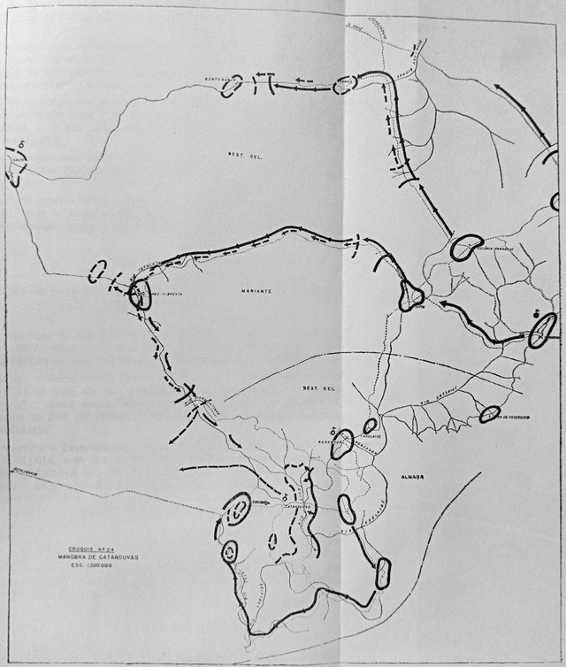

_Croquis 24 – Manobra de Catanduvas, 1:200.000. Domínio público; autor
desconhecido. Referência histórica, não planta do mapa do jogo._

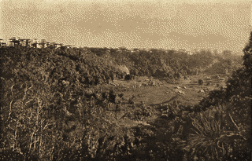

_Vista das trincheiras rebeldes em Catanduvas depois da ocupação, 1924.
Domínio público; Thomaz Luiz Reis._

---

## 05 · A Ponte de Verdinho

**Vaga:** Campanha → 05 A Ponte de Verdinho  
**ID do arquivo:** `ponte-de-verdinho`  
**Data:** 27–28 de junho de 1925  
**Comandante:** Luís Carlos Prestes  
**Rótulo:** dramatizado

### O que o mapa precisa provar

A ponte é um relógio. Segurar até as carroças passarem, entregar a ponte na hora
certa e sair pelo vau. O mapa ensina negação de passagem e retirada por água
rasa.

### Ficha técnica

| Campo | Sugestão |
| --- | --- |
| Tamanho | Pequeno (240 m) |
| Paleta | `cerrado` |
| Chão base | `cerrado-grass` |
| Nível da água | 0 m |
| Luz | 6h30, sol a leste (bearing 90) |
| Norte | 0° |
| Cenário | `historical-setting-fictional-place` |
| Codex | `map-serra-rio` |
| Nota de fonte | `macaulay-1974`, cap. V, pp. 122–124. |
| Forças inimigas (opcional) | `brigada-militar`; `provisorios`; `metralhadora-legalista`. |

### Croqui

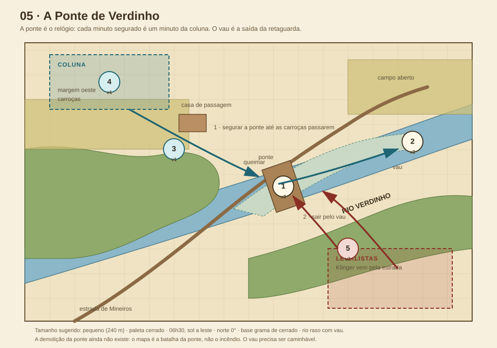

### Leitura do terreno

- **Rio Verdinho** diagonal: água rasa no vau, funda fora dele.
- **Ponte** no centro: única passagem seca, gargalo e objetivo.
- **Vau** a leste: saída da retaguarda; água rasa.
- **Mata de galeria** nas margens: cobertura e ocultação.
- **Campo aberto** nos acessos: perigoso, mas necessário para a estrada.
- **Estrada de Mineiros** cruza o rio pela ponte.

### Ordem de desenho

1. Pinte o rio diagonal; marque o trecho fundo e o trecho de vau.
2. Desenhe a ponte sobre o trecho fundo; a ponte precisa estar sobre água.
3. Desenhe o vau como água rasa caminhável, com areia/pedras.
4. Trace a estrada de Mineiros, passando pela ponte; valas nos acessos.
5. Pinte a mata de galeria nas duas margens; deixe clareiras nas cabeceiras.
6. Coloque `rancho`, `venda`, `ferry-house` se quiser; nada de vila grande.
7. Espalhe cobertura: árvores, troncos, pedras, carroças, cerca.
8. Desenhe a coluna a noroeste e os legalistas a sudeste.
9. Coloque os objetivos: ponte, vau, margem oeste, estrada, aproximação leste.
10. Verifique se a ponte e o vau são caminháveis para os dois lados.

### Objetivos sugeridos

| # | PT-BR | EN | Valor | Raio | Dono inicial | Onde |
| --- | --- | --- | --- | --- | --- | --- |
| 1 | Ponte | Bridge | 3 | 16 m | Ninguém | No centro da ponte |
| 2 | Vau | Ford | 2 | 16 m | Ninguém | No vau, a leste |
| 3 | Margem Oeste | West Bank | 1 | 18 m | A coluna | Na cabeceira oeste |
| 4 | Estrada de Mineiros | Mineiros Road | 1 | 18 m | A coluna | Na estrada, a noroeste |
| 5 | Aproximação Leste | East Approach | 1 | 18 m | Os legalistas | Na estrada, a sudeste |

### Cobertura e cuidados

- A ponte é o gargalo; não a cubra com árvores que escondam o tabuleiro.
- O vau precisa ser óbvio na vista de cima: areia, pedras, água clara.
- A mata de galeria é cobertura, mas não pode fechar a estrada.
- A demolição da ponte não existe no jogo. O mapa é a batalha da ponte; o
  incêndio é script futuro. Não remova a ponte depois do teste.
- O objetivo da ponte pode ficar na cabeceira ou no tabuleiro; confirme que a
  bandeira não está em água funda.

### Referências

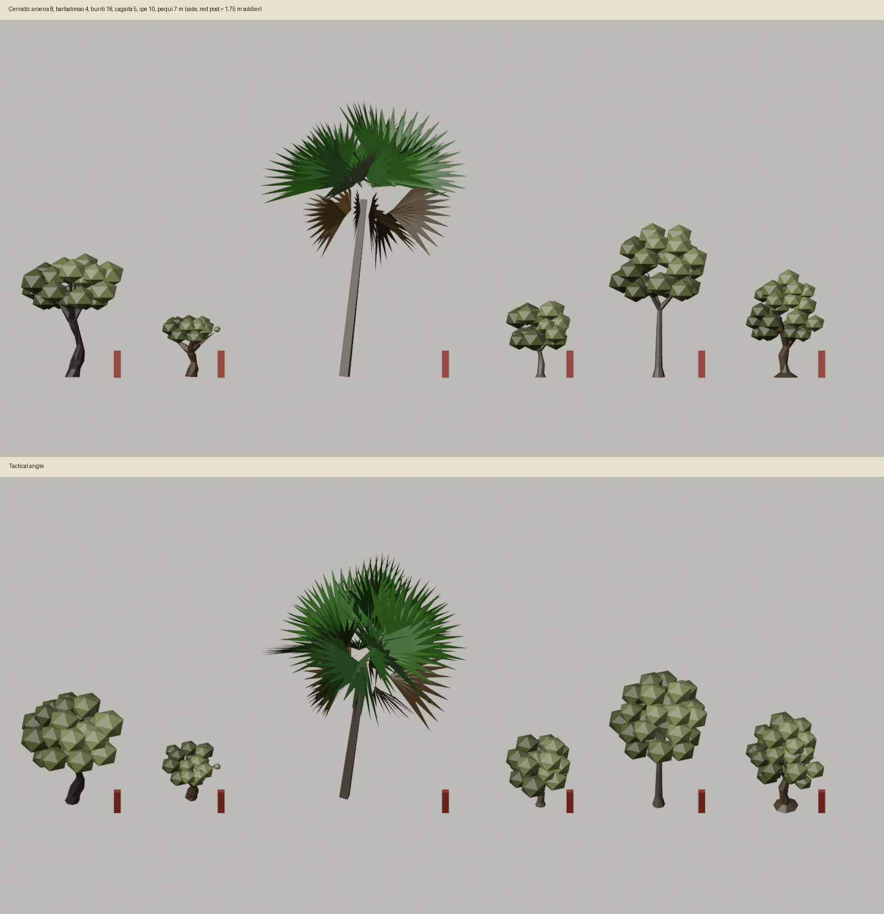

_Referência de cerrado do jogo: árvores baixas, capim e chão claro. O Verdinho
é uma paisagem de cerrado com mata de galeria, não uma floresta fechada._

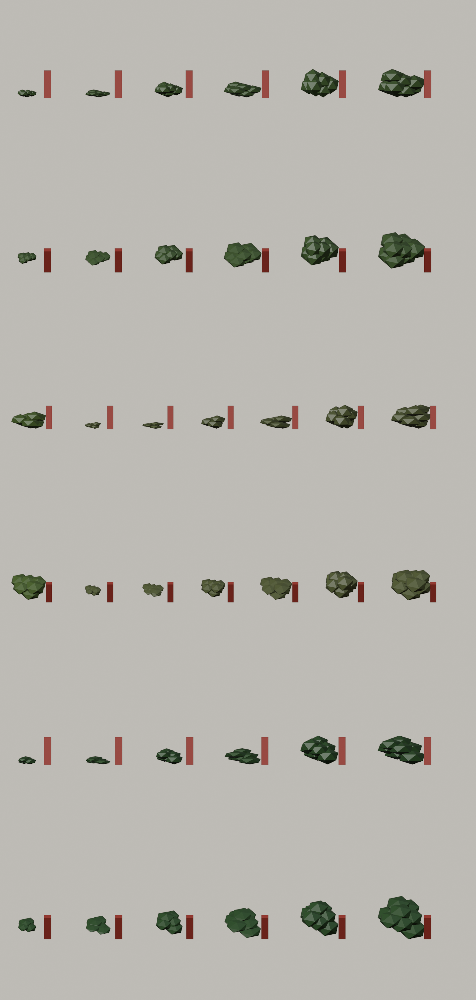

_Referência de arbustos e mato rasteiro para as margens e os campos._

---

## 06 · Serra Nova

**Vaga:** Campanha → 06 Serra Nova  
**ID do arquivo:** `serra-nova`  
**Data:** 22–26 de abril de 1926  
**Comandante:** Luís Carlos Prestes  
**Rótulo:** dramatizado

### O que o mapa precisa provar

Não é um desfiladeiro: é uma serra com estradas, cerrado e retaguarda. A coluna
vira; a retaguarda cede terreno, quebra o contato e segue para Taiobeiras.

### Ficha técnica

| Campo | Sugestão |
| --- | --- |
| Tamanho | Médio (400 m) |
| Paleta | `cerrado` |
| Chão base | `cerrado-grass` |
| Nível da água | 0 m (sem água) |
| Luz | 6h30, sol a leste (bearing 90) |
| Norte | 0° |
| Cenário | `historical-setting-fictional-place` |
| Codex | `serra-nova` |
| Nota de fonte | `macaulay-1974`, cap. VIII, pp. 220–221; `nascimento-2026`; `almg-2026`. |
| Forças inimigas (opcional) | `jaguncos`; `jaguncos-mauser`; `infantaria-exercito`. |

### Croqui

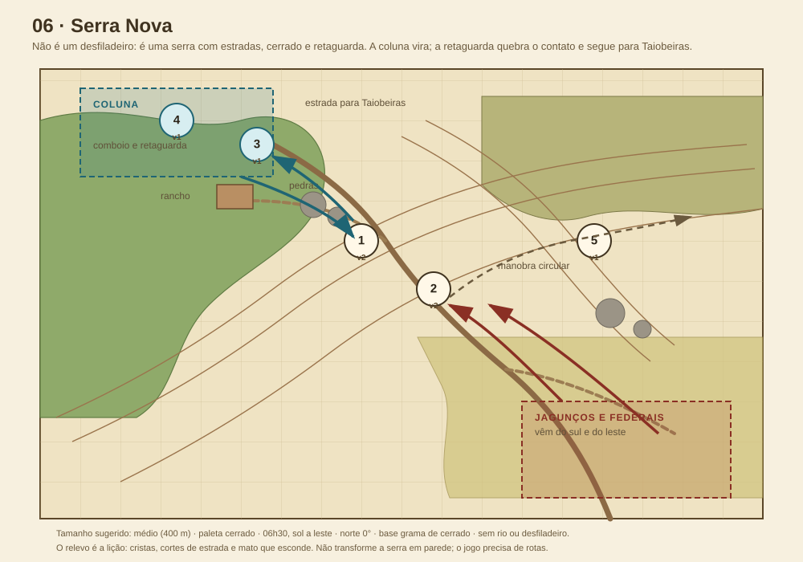

### Leitura do terreno

- **Serra** no centro-oeste: cristas, pedras, cortes de estrada.
- **Estradas** cruzam o mapa; o cruzamento é o objetivo tático.
- **Cerrado** no leste e no sul: cobertura baixa, ocultação.
- **Mata** no noroeste: cobertura e esconderijo.
- **Taiobeiras** ao norte: a saída da coluna.
- **Jagunços e federais** vêm do sul e do leste.

### Ordem de desenho

1. Modele as cristas com elevações suaves (1–5 m), não com penhascos.
2. Use **Curvas** para conferir as cotas; evite cristas que fechem todas as
   rotas.
3. Trace as estradas: uma de sul a norte, uma de leste a oeste, com um
   cruzamento claro.
4. Pinte a mata no noroeste e o cerrado no leste/sul.
5. Coloque pedras, lajedos e cortes de estrada; use `outcrop`, `matacao`,
   `lajedo-slab`, `stone-pile`.
6. Coloque `rancho`, `wattle-house`, `venda`, `chapel` com moderação.
7. Espalhe cobertura: pedras, muros de pedra, árvores, arbustos, troncos.
8. Desenhe a coluna a noroeste e os jagunços/federais a sudeste.
9. Coloque os objetivos: retaguarda, cruzamento, estrada de Taiobeiras, comboio,
   mata do flanco.
10. Verifique se o cruzamento e a estrada de Taiobeiras têm caminho para os dois
    lados.

### Objetivos sugeridos

| # | PT-BR | EN | Valor | Raio | Dono inicial | Onde |
| --- | --- | --- | --- | --- | --- | --- |
| 1 | Retaguarda da Serra | Serra Rearguard | 2 | 22 m | Ninguém | Na crista central |
| 2 | Cruzamento das Estradas | Road Fork | 2 | 20 m | Ninguém | No cruzamento |
| 3 | Estrada de Taiobeiras | Taiobeiras Road | 1 | 20 m | A coluna | Na estrada, ao norte |
| 4 | Comboio de Suprimentos | Supply Train | 1 | 18 m | A coluna | No noroeste, atrás da serra |
| 5 | Mata do Flanco | Flank Woods | 1 | 20 m | Ninguém | Na mata do flanco leste |

### Cobertura e cuidados

- A crista não deve ser uma parede: deixe ombros e passagens.
- O cruzamento precisa de cobertura dos dois lados; pedras, muros, árvores.
- Não pinte rio nem desfiladeiro: a missão cortou o “passo” e o rio do rascunho.
- O comboio fica atrás da serra, mas precisa de caminho; não o prenda.
- Se o mapa ficar aberto demais, adicione capim, arbustos e pedras ao longo das
  estradas; o cerrado é a cobertura natural.

### Referências


_Referência de cerrado: pequi, aroeira, barbatimão, cagaita, ipê e arbustos._


_Referência de arbustos para o sub-bosque e as encostas._

Não há foto histórica confirmada de Serra Nova no repositório. Não use uma
imagem gerada como se fosse foto de 1926; use o cerrado do jogo e a nota de
fonte.

---

## 07 · O Pantanal

**Vaga:** Campanha → 07 O Pantanal  
**ID do arquivo:** `pantanal`  
**Data:** janeiro a março de 1927  
**Comandante:** Luís Carlos Prestes  
**Rótulo:** dramatizado

### O que o mapa precisa provar

A marcha é o inimigo. O mapa é aberto, molhado e sem cobertura dura; a coluna
segue a trilha de gado, atravessa vaus e chega à fronteira. A escassez de
cobertura é a lição, não um erro.

### Ficha técnica

| Campo | Sugestão |
| --- | --- |
| Tamanho | Grande (640 m) |
| Paleta | `cerrado` |
| Chão base | `mud` |
| Nível da água | 0 m |
| Luz | 6h, sol a leste (bearing 90) |
| Norte | 0° |
| Cenário | `historical-setting-fictional-place` |
| Codex | `pantanal` |
| Nota de fonte | `macaulay-1974`, cap. IX, pp. 230–234. |
| Forças inimigas (opcional) | `infantaria-exercito`; `provisorios`. |

### Croqui

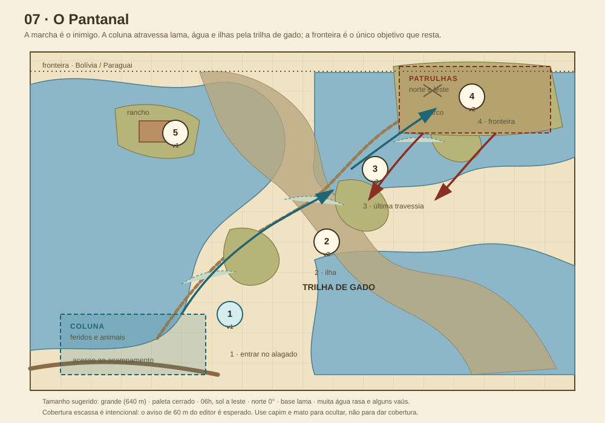

### Leitura do terreno

- **Água** em grandes manchas; água funda como borda, vaus como passagem.
- **Lama** e capim: terreno lento, pouca cobertura.
- **Ilhas** e cordões de terra: objetivos e descanso.
- **Trilha de gado** serpenteia para o norte; é o eixo da marcha.
- **Fronteira** ao norte: Bolívia/Paraguai; o fim da marcha.
- **Patrulhas** ao norte e a leste; não são uma linha de frente.

### Ordem de desenho

1. Pinte a base de lama e as manchas de água; deixe vaus claros.
2. Desenhe a trilha de gado de sul a norte, com curvas e alargamentos.
3. Coloque ilhas e cordões de terra; use capim e arbustos.
4. Espalhe `buriti`, `ipe`, arbustos e capim; nada de mata densa.
5. Coloque poucas construções: `rancho`, `wattle-house`, `ferry-house`.
6. Espalhe cobertura escassa: troncos, carroças, montes de feno, pedras.
7. Desenhe a coluna no sudoeste e as patrulhas no nordeste.
8. Coloque os objetivos: trilha, ilha, última travessia, marco, rancho.
9. Verifique se todos os objetivos são alcançáveis por vaus; se não, mova a
   bandeira para a margem.
10. Aceite o aviso de cobertura de 60 m: ele é parte do desenho.

### Objetivos sugeridos

| # | PT-BR | EN | Valor | Raio | Dono inicial | Onde |
| --- | --- | --- | --- | --- | --- | --- |
| 1 | Trilha de Gado | Cattle Trail | 1 | 18 m | A coluna | Na trilha, ao sul |
| 2 | Ilha | Island | 2 | 20 m | Ninguém | Na ilha central |
| 3 | Última Travessia | Last Crossing | 3 | 18 m | Ninguém | No vau antes da fronteira |
| 4 | Marco da Fronteira | Border Marker | 2 | 20 m | Ninguém | No marco, ao norte |
| 5 | Rancho | Ranch | 1 | 18 m | Ninguém | No rancho, a oeste |

### Cobertura e cuidados

- Não tente “consertar” a falta de cobertura com mata densa: o Pantanal é
  aberto. Use capim e mato para ocultar, troncos e carroças para cobrir.
- Cada vau precisa ser caminhável; não deixe objetivo em ilha sem vau.
- A fronteira é uma linha visual; não precisa ser um muro. Use uma cerca, um
  marco, uma trilha.
- O mapa grande pode ficar lento; teste o tempo de marcha. Se necessário,
  reduza para 400 m ou aproxime os objetivos.
- Não use a paleta `amazonia`: o Pantanal não é a floresta amazônica.

### Referências


_Referência de vegetação baixa: capim, arbustos e mato. A cobertura do Pantanal
é ocultação, não muro._


_Referência de árvores de cerrado e buriti para as ilhas e cordões._

O manifesto de imagens lista `TrajetoColunaMatoGrosso.jpg` como candidato, mas ele não foi
baixado; é um mapa moderno de rota, não o cruzamento de 1927. Não o use como
planta histórica.

---

## 08 · La Gaiba

**Vaga:** Campanha → 08 La Gaiba  
**ID do arquivo:** `la-gaiba`  
**Data:** 5 de julho de 1927  
**Comandante:** Prestes e os exilados  
**Rótulo:** dramatizado

### O que o mapa precisa provar

Não há batalha. A clareira, o monumento e os exilados são a cena. O mapa serve
para lembrar o custo da marcha, não para capturar pontos.

### Ficha técnica

| Campo | Sugestão |
| --- | --- |
| Tamanho | Pequeno (240 m) |
| Paleta | `cerrado` ou `caatinga` |
| Chão base | `dry-grass` |
| Nível da água | 0 m |
| Luz | 16h30, sol a oeste (bearing 250) |
| Norte | 0° |
| Cenário | `historical-setting-fictional-place` |
| Codex | `la-gaiba` |
| Nota de fonte | `blanc-2024`, cap. 7 e fig. 7.5; `macaulay-1974`, cap. IX, pp. 230–234 (não menciona La Gaiba). |
| Forças inimigas | Nenhuma. Não adicione inimigo simbólico. |

### Croqui

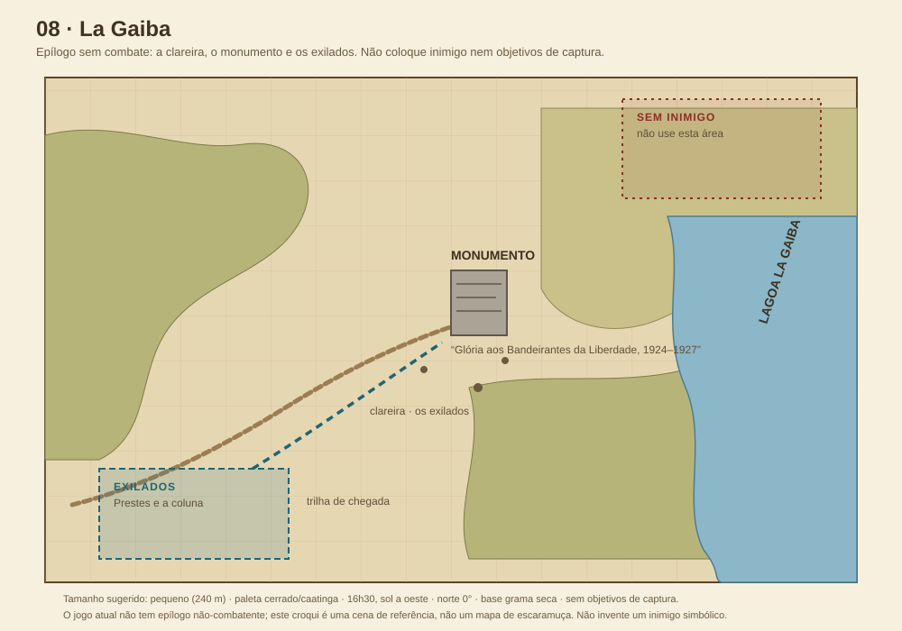

### Leitura do terreno

- **Clareira** seca no centro: o monumento e os exilados.
- **Mato baixo** ao redor: Chaco, cerrado, caatinga; nada de floresta.
- **Lagoa** a leste: água, borda da cena.
- **Trilha** de chegada: de onde os exilados vêm.
- **Fronteira** e distância: o que ficou para trás.

### Ordem de desenho

1. Pinte a base seca e a clareira.
2. Pinte a lagoa a leste e o mato ao redor.
3. Desenhe a trilha de chegada.
4. Coloque o monumento: o catálogo não tem um objeto “monumento”. Use
   `lajedo-slab` + `stone-pile`/`boulder` como base, ou desenhe a cena com
   objetos de pedra. Se quiser um monumento de verdade, isso é um objeto novo,
   fora deste guia.
5. Coloque poucos arbustos, `umbuzeiro`, `barbatimao`, capim.
6. Desenhe a área dos exilados; a área legalista fica vazia e longe.
7. Não coloque objetivos de captura. Se quiser um marco de cena, use
   “Monumento” valor 1, dono a coluna, raio 12 m, apenas como referência.
8. Rode **Verificar mapa** e ignore o aviso de objetivos (o mapa de campanha não
   é obrigado a 3–5). Mas não o salve como escaramuça.

### Objetivos sugeridos

Nenhum objetivo de captura. Se precisar de um marco de cena:

| # | PT-BR | EN | Valor | Raio | Dono inicial | Onde |
| --- | --- | --- | --- | --- | --- | --- |
| 1 | Monumento | Monument | 1 | 12 m | A coluna | Na clareira, junto ao monumento |

### Cobertura e cuidados

- Não invente um inimigo. A missão não tem combate.
- Não transforme a cena em escaramuça: o jogo atual não tem epílogo
  não-combatente; o playtest do editor vai criar um 3 vs 3, que não é a missão.
- Use a paleta seca e a luz baixa para o tom de fim de tarde.
- O monumento é uma peça de cena; se o objeto não existir, registre a falta no
  guia de assets, não falsifique uma foto histórica.

### Referências

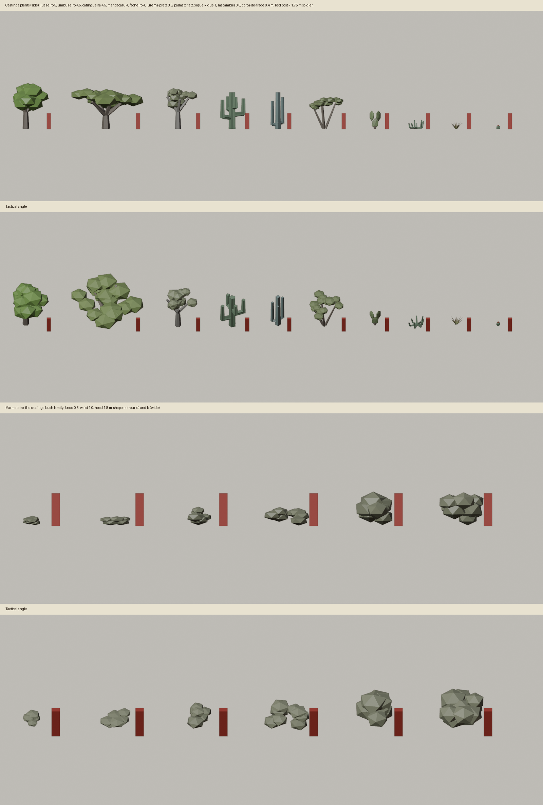

_Referência de vegetação seca e espinhosa. La Gaiba é Chaco boliviano; use como
referência de clima e porte, não como bioma exato._

O manifesto de imagens cita `LaGaibaSatellite.png` e `LaGaibaMap.jpg` como referências
modernas (NASA/PCL), mas elas não foram baixadas. Se usar, legendas devem dizer
que são imagens modernas, não de 1927.

---

## Checklist antes de salvar

### Nomes e metadados

- [ ] ID em minúsculas com hífens; o arquivo vira `<id>.map.json`.
- [ ] Nome e descrição em PT-BR e EN.
- [ ] Vaga de campanha correta; `mission` preenchido.
- [ ] Rótulo de cenário e nota de fonte citando `docs/history/SOURCES.md`.
- [ ] Paleta, chão base, nível da água, luz e norte conferidos.

### Desdobramento

- [ ] 3 seções por lado.
- [ ] Áreas a pelo menos 160 m entre centros.
- [ ] Áreas não se sobrepõem.
- [ ] Cada área pelo menos 50% caminhável.
- [ ] Cada seção dentro da sua área.
- [ ] Caminho a pé entre os dois lados.

### Objetivos

- [ ] 3–5 objetivos nos mapas jogáveis.
- [ ] Nome em PT-BR e EN.
- [ ] Valor 1–3.
- [ ] Raio 12–30 m.
- [ ] Bandeira fora de água funda e de construção.
- [ ] Nenhum objetivo sobre outro.
- [ ] Todos alcançáveis a partir dos dois desdobramentos.
- [ ] Dono inicial coerente com a missão.

### Terreno

- [ ] Cobertura a cada 40–60 m no eixo; aviso de 60 m lido e aceito ou corrigido.
- [ ] Nenhuma planta em água, ponte, estrada calçada, construção ou trincheira.
- [ ] Nenhuma construção sobre outra.
- [ ] Pontes sobre água; balsas e vaus ligando as margens.
- [ ] Trilhas e estradas não cortadas por muros sem passagem.
- [ ] Quintais com passagem de pelo menos 2 m.
- [ ] Nenhum objeto fora dos limites.

### Jogo

- [ ] **Verificar mapa** sem erros.
- [ ] Playtest 3 vs 3 no mapa.
- [ ] A batalha termina; o tempo de jogo é razoável.
- [ ] A cobertura e a ocultação fazem sentido na vista **Cobertura**.
- [ ] A luz e o norte não mudam a simulação, só a leitura.
- [ ] Miniatura salva e conferida.

## Erros comuns e como evitar

| Problema | Causa | Correção |
| --- | --- | --- |
| Eixo aberto demais | campos grandes sem cobertura | pedras, muros, valas, carroças, capim a cada 40–60 m |
| Quintal fechado | muros sem passagem | deixe 2 m entre muros e a casa |
| Objetivo inalcançável | bandeira em água/construção ou atrás de bloqueio | mova para chão seco e caminhável |
| Objetivos sobrepostos | raios grandes no mesmo lugar | afaste ou reduza o raio |
| Desdobramento em água | área pintada sobre rio/lagoa | mova a área ou o vau |
| Ponte fora da água | ponte decorativa | coloque sobre rio/lagoa fundos |
| Planta apagada | vegetação em água, estrada, construção ou trincheira | remova ou mova para terra |
| Balsa sem caminho | landings fora da margem | alinhe as duas margens |
| Mapa grande lento | 640 m com muita coisa | teste; reduza para 400 m se necessário |
| Fonte ausente | mapa de campanha sem nota | cite `docs/history/SOURCES.md` |
| Inimigo em La Gaiba | hábito de escaramuça | não adicione inimigo; é epílogo |

## Referências visuais do jogo

### Vegetação


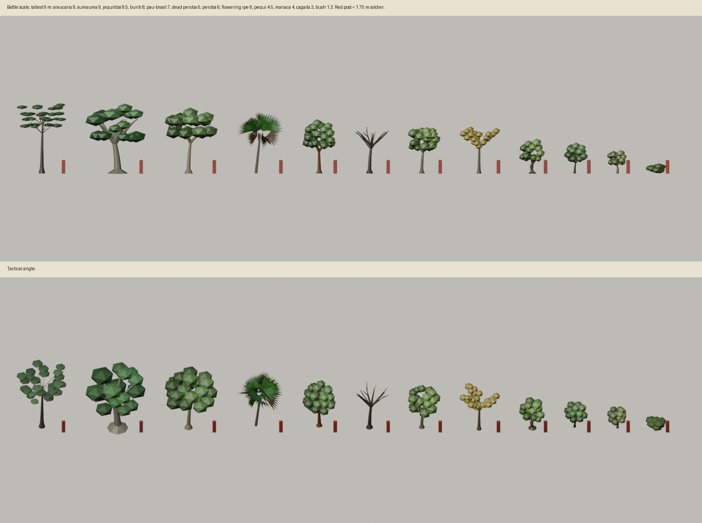

### Construções

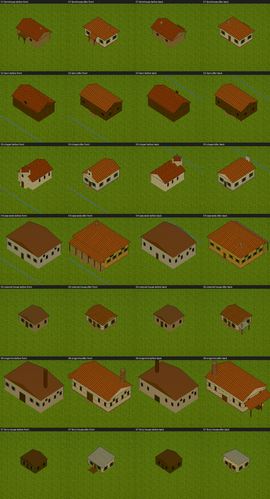

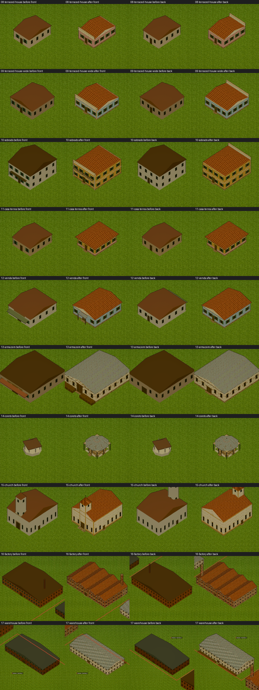

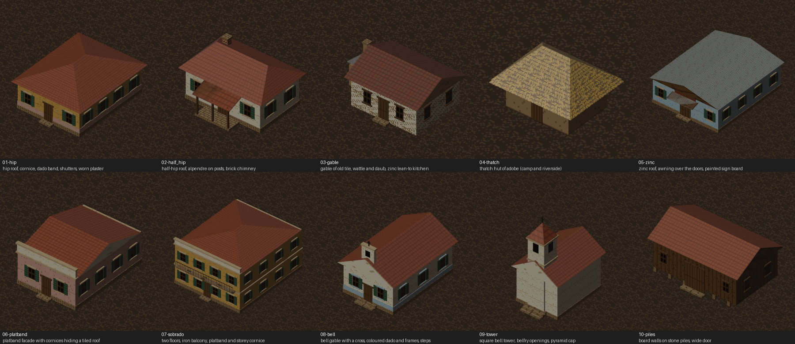

### Mapas e fotos históricas já no repositório

| Referência | Arquivo | Direitos | Uso |
| --- | --- | --- | --- |
| Copacabana, 1922 | `apps/game/public/assets/compendium/forte-copacabana/fort-plan.png` | domínio público, Serviço Geográfico Militar | missão 01 |
| Os 18 na praia | `apps/game/public/assets/compendium/revolt-1922/beach-illustration.png` | domínio público; crédito pendente | missão 01 |
| Catanduvas, Croquis 24 | `apps/game/public/assets/compendium/map-fazenda/map.png` | domínio público; autor desconhecido | missão 04 |
| Trincheiras de Catanduvas | `apps/game/public/assets/compendium/map-fazenda/hero-photo.png` | domínio público, Thomaz Luiz Reis | missão 04 |
| Comando da coluna | `apps/game/public/assets/compendium/luis-carlos-prestes/column-photo.png` | domínio público, CPDOC/FGV | missões 02–03 |
| Isidoro e Miguel Costa | `apps/game/public/assets/compendium/foz-do-iguacu/group-photo.png` | domínio público; crédito pendente | missão 03 |

Não redistribua mapas de livros. O material de `livros/` é gitignored e serve só
para consulta. Não use uma imagem gerada como se fosse fotografia histórica.

## Ordem de produção sugerida

Se for desenhar os oito, esta ordem reduz retrabalho:

1. **05 Verdinho** (pequeno): aprende rio, ponte, vau e objetivos.
2. **01 Copacabana** (médio): aprende borda de água, corredor e retirada.
3. **02 Anel de Ferro** (médio): aprende estrada, cidade, vau e rio.
4. **06 Serra Nova** (médio): aprende relevo, estradas e cruzamento.
5. **04 Frente do Paraná** (médio): aprende trincheiras, fazenda e retirada.
6. **03 A Divisão** (grande): aprende balsa, vau e margem oposta.
7. **07 Pantanal** (grande): aprende água, lama e cobertura escassa.
8. **08 La Gaiba** (pequeno): fecha a campanha com uma cena, não uma batalha.

Se um mapa não estiver ensinando nada no playtest, volte ao croqui e corte uma
área. Um mapa menor que ensina é melhor que um mapa grande que só ocupa espaço.

## O que não fazer

- Não gerar mapas por código nem escrever `.map.json` à mão; o mapa é desenhado
  no editor.
- Não adicionar sistemas, objetos ou armas que o jogo não tem.
- Não usar artilharia jogável; ela não existe.
- Não fingir que o rio, a ponte ou a balsa funcionam sem testar o caminho.
- Não colocar vegetação em água, estrada calçada, construção ou trincheira.
- Não fechar quintais, ruas ou gargalos sem passagem.
- Não usar foto histórica sem direitos; não gerar foto falsa.
- Não transformar La Gaiba em escaramuça.
- Não transformar Serra Nova em desfiladeiro; a missão é emboscada e manobra.
- Não transformar o Pantanal em floresta; a lição é a ausência de cobertura.
- Não commitar `livros/`, `fotos dos personages/` ou qualquer material
  gitignored.

## Arquivos deste guia

- `docs/maps/GUIA_MAPAS_CAMPANHA.md` — este texto.
- `docs/maps/croquis/00-legenda.svg` — símbolos.
- `docs/maps/croquis/00-rota-geral.svg` — rota de conjunto.
- `docs/maps/croquis/01-copacabana.svg` a `08-la-gaiba.svg` — um croqui por
  missão.

Os croquis são SVG editáveis: abra no navegador para consultar ou no Inkscape
para ajustar as massas antes de desenhar no editor.

Para a especificação do editor e das regras, leia `docs/map-editor.md`,
`openspec/specs/battle-maps/spec.md` e `openspec/specs/map-objectives/spec.md`.
Para a história, leia `docs/history/TIMELINE.md`, `docs/history/SOURCES.md` e as
fichas em `docs/campaign/missions/`.
